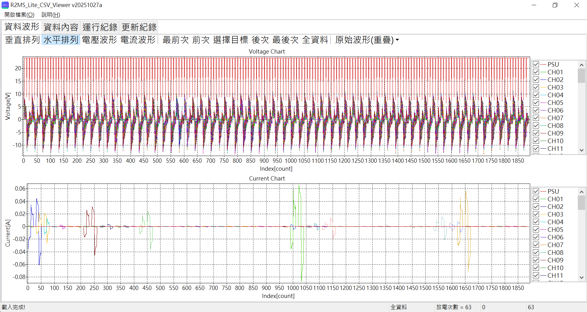
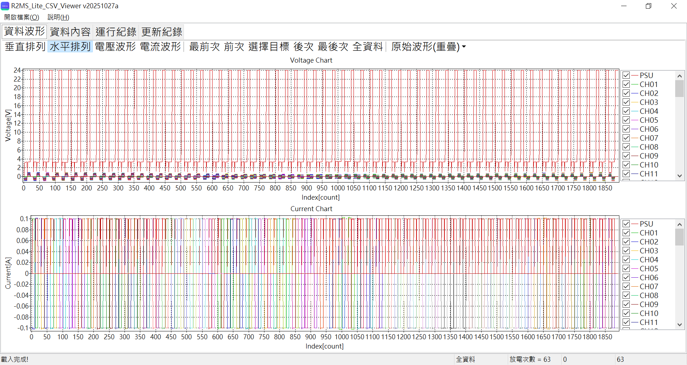
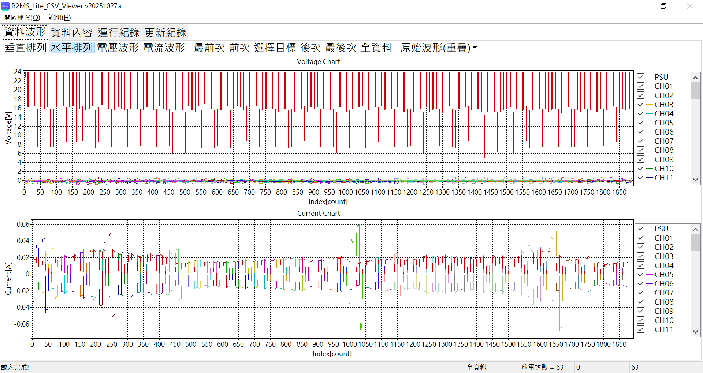
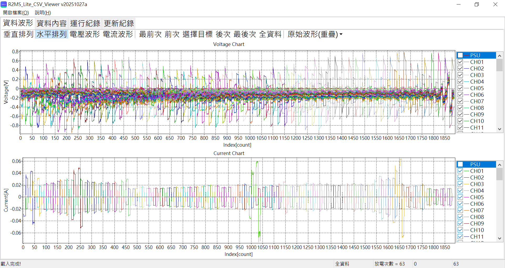
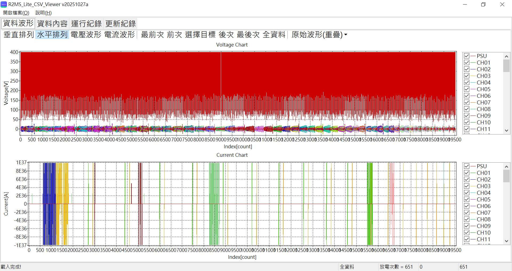
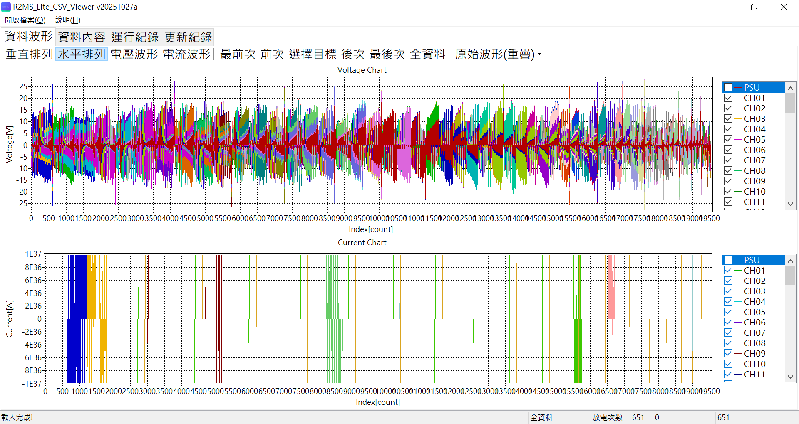

# SwitchArray-2026-S000 維修檢測完成紀錄
+ 室外檢測完成日期: 2026-11-20


### 時間序列檢視
| 室內浮接測試時間序列 PSU:SHOW S000202611241219 |
| :---: |
|  |

| 室內浮接測試時間序列 PSU:HIDE S000202611241219 |
| :---: |
|  |

| 室內標準地層測試時間序列 PSU:SHOW S000202611201450 |
| :---: |
|  |

| 室內標準地層測試時間序列 PSU:HIDE S000202611201450 |
| :---: |
|  |

### R2MS_Lite_CSV_CurrentQC 分析摘要

- **來源檔案**：`S000202611201450.v299T.csv`
- **產生時間**：2026-11-24 12:45:39
- **程式版本**：R2MS_Lite_CSV_CurrentQC v20261030b
- **資料筆數**：原始 1890 筆 → 篩選後 1134 筆（每 10 筆保留 3~8）
- **判定標準**：AVG(MEAS/PSU) > 115.00%
- **BOARD 對應**：CH01–CH08 = BOARD 01、CH09–CH16 = BOARD 02、…、CH57–CH64 = BOARD 08

```
BOARD,CH,AVG(MEAS)[A],AVG(PSU)[A],AVG(MEAS/PSU)[%],count,BOARD,CH,AVG(MEAS)[A],AVG(PSU)[A],AVG(MEAS/PSU)[%],count
01,CH01,0.100023395,0.100026667,100.00,12,02,CH09,0.100823523,0.100051667,100.77,24
01,CH02,0.100899280,0.100038750,100.86,24,02,CH10,0.099782320,0.100052083, 99.73,24
01,CH03,0.100472042,0.100050833,100.42,24,02,CH11,0.099973705,0.100052083, 99.92,24
01,CH04,0.100137717,0.100050833,100.09,24,02,CH12,0.100124342,0.100052083,100.07,24
01,CH05,0.099704560,0.100050417, 99.65,24,02,CH13,0.100042473,0.100052500, 99.99,24
01,CH06,0.099841776,0.100050000, 99.79,24,02,CH14,0.099947930,0.100052083, 99.90,24
01,CH07,0.100017170,0.100050417, 99.97,24,02,CH15,0.099851674,0.100051667, 99.80,24
01,CH08,0.100135714,0.100051250,100.08,24,02,CH16,0.100410943,0.100051667,100.36,24
03,CH17,0.100290171,0.100052083,100.24,24,04,CH25,0.100369603,0.100052500,100.32,24
03,CH18,0.099836123,0.100052083, 99.78,24,04,CH26,0.099950752,0.100052500, 99.90,24
03,CH19,0.099966922,0.100051667, 99.92,24,04,CH27,0.099852320,0.100052083, 99.80,24
03,CH20,0.099862691,0.100050833, 99.81,24,04,CH28,0.100075971,0.100051667,100.02,24
03,CH21,0.099885438,0.100050000, 99.84,24,04,CH29,0.099819946,0.100052083, 99.77,24
03,CH22,0.099909252,0.100050833, 99.86,24,04,CH30,0.099925215,0.100052083, 99.87,24
03,CH23,0.099754855,0.100051667, 99.70,24,04,CH31,0.099944421,0.100052083, 99.89,24
03,CH24,0.100131931,0.100052083,100.08,24,04,CH32,0.099884920,0.100052083, 99.83,24
05,CH33,0.099996113,0.100051667, 99.94,24,06,CH41,0.100128775,0.100051250,100.08,24
05,CH34,0.099776782,0.100052083, 99.72,24,06,CH42,0.099810628,0.100051250, 99.76,24
05,CH35,0.102514849,0.100052500,102.46,24,06,CH43,0.100258103,0.100051250,100.21,24
05,CH36,0.099769114,0.100052500, 99.72,24,06,CH44,0.099954760,0.100051667, 99.90,24
05,CH37,0.100058092,0.100052083,100.01,24,06,CH45,0.100438843,0.100051250,100.39,24
05,CH38,0.099980090,0.100051667, 99.93,24,06,CH46,0.100307152,0.100050833,100.26,24
05,CH39,0.100149599,0.100051667,100.10,24,06,CH47,0.100423891,0.100051250,100.37,24
05,CH40,0.099893421,0.100051250, 99.84,24,06,CH48,0.099922760,0.100051667, 99.87,24
07,CH49,0.099978006,0.100051250, 99.93,24,08,CH57,0.099737678,0.100051250, 99.69,24
07,CH50,0.099819381,0.100050833, 99.77,24,08,CH58,0.100113851,0.100051250,100.06,24
07,CH51,0.099617471,0.100051250, 99.57,24,08,CH59,0.100352687,0.100051250,100.30,24
07,CH52,0.099770631,0.100051250, 99.72,24,08,CH60,0.100133502,0.100051250,100.08,24
07,CH53,0.100695368,0.100051250,100.64,24,08,CH61,0.099899472,0.100051250, 99.85,24
07,CH54,0.099899546,0.100051250, 99.85,24,08,CH62,0.099875040,0.100050833, 99.82,24
07,CH55,0.100287221,0.100051250,100.24,24,08,CH63,0.099944893,0.100050833, 99.89,24
07,CH56,0.101655824,0.100051667,101.60,24,08,CH64,0.100090032,0.100050833,100.04,12
```

超標通道：無


| 野外測試時間序列 PSU:SHOW S000202611201503 |
| :---: |
|  |

| 野外測試時間序列 PSU:HIDE S000202611201503 |
| :---: |
|  |

## R2MS_Lite_CSV_CurrentQC 分析摘要

- **來源檔案**：`S000202611201503.v299T.csv`
- **產生時間**：2026-11-24 12:52:52
- **程式版本**：R2MS_Lite_CSV_CurrentQC v20261030b
- **資料筆數**：原始 1890 筆 → 篩選後 1134 筆（每 10 筆保留 3~8）
- **判定標準**：AVG(MEAS/PSU) > 115.00%
- **BOARD 對應**：CH01–CH08 = BOARD 01、CH09–CH16 = BOARD 02、…、CH57–CH64 = BOARD 08

```
BOARD,CH,AVG(MEAS)[A],AVG(PSU)[A],AVG(MEAS/PSU)[%],count,BOARD,CH,AVG(MEAS)[A],AVG(PSU)[A],AVG(MEAS/PSU)[%],count
01,CH01,0.019177128,0.018351667,104.50,12,02,CH09,0.043514178,0.027825000,156.66,24
01,CH02,0.037376310,0.017256667,219.75,24,02,CH10,0.026000477,0.025793750,100.93,24
01,CH03,0.026071415,0.016921667,153.84,24,02,CH11,0.025185750,0.023423333,107.61,24
01,CH04,0.019350452,0.019019167,101.58,24,02,CH12,0.022940634,0.022359583,102.65,24
01,CH05,0.022402341,0.021221250,105.53,24,02,CH13,0.023025737,0.022269583,103.40,24
01,CH06,0.024327697,0.024254583,100.17,24,02,CH14,0.022874927,0.022635000,101.08,24
01,CH07,0.027518015,0.027060417,101.68,24,02,CH15,0.021550261,0.020779583,103.83,24
01,CH08,0.028191931,0.027877083,101.13,24,02,CH16,0.027592267,0.016092500,179.90,24
03,CH17,0.013688599,0.013374583,102.35,24,04,CH25,0.016066410,0.015707083,102.28,24
03,CH18,0.015153151,0.015091667,100.30,24,04,CH26,0.016430481,0.016219167,101.29,24
03,CH19,0.015561943,0.015381667,101.27,24,04,CH27,0.017031868,0.016950000,100.47,24
03,CH20,0.014380989,0.014272083,100.76,24,04,CH28,0.018467562,0.018206250,101.40,24
03,CH21,0.014476126,0.014377917,100.70,24,04,CH29,0.018518063,0.018404167,100.67,24
03,CH22,0.014831454,0.014645417,101.25,24,04,CH30,0.016816092,0.016627917,101.20,24
03,CH23,0.015522953,0.015456250,100.39,24,04,CH31,0.016069932,0.015923750,100.89,24
03,CH24,0.015907346,0.015724583,101.19,24,04,CH32,0.017850955,0.017709583,100.71,24
05,CH33,0.019871815,0.019352083,102.68,24,06,CH41,0.017583721,0.017413750,100.96,24
05,CH34,0.019191309,0.017696667,108.94,24,06,CH42,0.019766228,0.019711667,100.20,24
05,CH35,0.048676798,0.014592500,341.93,24,06,CH43,0.021547504,0.021370417,100.85,24
05,CH36,0.015094589,0.014497917,103.96,24,06,CH44,0.021424328,0.021312083,100.54,24
05,CH37,0.018335852,0.016547500,110.55,24,06,CH45,0.021245965,0.021095833,100.74,24
05,CH38,0.018088187,0.017518333,103.27,24,06,CH46,0.019878884,0.019637500,101.28,24
05,CH39,0.022792312,0.018017083,126.22,24,06,CH47,0.018928499,0.018708333,101.18,24
05,CH40,0.017924518,0.017756667,101.00,24,06,CH48,0.019582631,0.019475000,100.54,24
07,CH49,0.021271382,0.020519583,103.65,24,08,CH57,0.018479426,0.018315833,101.01,24
07,CH50,0.020869260,0.020445417,102.12,24,08,CH58,0.017262582,0.017140000,100.68,24
07,CH51,0.019901154,0.019468333,102.27,24,08,CH59,0.018973448,0.018800417,100.89,24
07,CH52,0.020629426,0.020225417,101.95,24,08,CH60,0.016664479,0.016564167,100.83,24
07,CH53,0.030548541,0.023714583,128.06,24,08,CH61,0.012918507,0.012709167,101.72,24
07,CH54,0.028342621,0.026648333,106.32,24,08,CH62,0.012764527,0.012669583,100.67,24
07,CH55,0.030431815,0.027806667,109.42,24,08,CH63,0.013726417,0.013563333,101.20,24
07,CH56,0.053995859,0.024290000,235.84,24,08,CH64,0.013652716,0.013747500, 99.31,12
```

超標通道（8 個）：CH02 (219.75%)、CH03 (153.84%)、CH09 (156.66%)、CH16 (179.90%)、CH35 (341.93%)、CH39 (126.22%)、CH53 (128.06%)、CH56 (235.84%)


| NCU草坪時間序列 PSU:SHOW S000202611201512 |
| :---: |
|  |

| NCU草坪時間序列 PSU:HIDE S000202611201512 |
| :---: |
|  |

### R2MS_Lite_CSV_CurrentQC 分析摘要

- **來源檔案**：`S000202611201512.v299S.csv`
- **產生時間**：2026-11-24 13:01:33
- **程式版本**：R2MS_Lite_CSV_CurrentQC v20261030b
- **資料筆數**：原始 19530 筆 → 篩選後 11718 筆（每 10 筆保留 3~8）
- **判定標準**：AVG(MEAS/PSU) > 115.00%
- **BOARD 對應**：CH01–CH08 = BOARD 01、CH09–CH16 = BOARD 02、…、CH57–CH64 = BOARD 08

```
BOARD,CH,AVG(MEAS)[A],AVG(PSU)[A],AVG(MEAS/PSU)[%],count,BOARD,CH,AVG(MEAS)[A],AVG(PSU)[A],AVG(MEAS/PSU)[%],count
01,CH01,0.398955366,0.317171389,                                     125.91,252,02,CH09,2289375000000002256400374236213936128.000000000,0.374104667, 535280008169409505184247248271288827904.00,240
01,CH02,9900000000000026732400056742082248704.000000000,0.294908125,3402212000132358165265117653106276958208.00,240,02,CH10,0.446990192,0.359842540,                                     124.64,252
01,CH03,7724062500000019818904494389921316864.000000000,0.288093333,2605385099548750589250925032662739451904.00,240,02,CH11,1.256126219,0.332861792,                                     378.57,240
01,CH04,0.446001609,0.324187738,                                     137.81,252,02,CH12,0.606585173,0.349936792,                                     174.57,240
01,CH05,1.024450037,0.317501125,                                     322.03,240,02,CH13,0.705327010,0.321889484,                                     222.26,252
01,CH06,0.372069642,0.353924583,                                     105.16,240,02,CH14,0.374505974,0.356798833,                                     104.99,240
01,CH07,0.480769442,0.364625159,                                     132.11,252,02,CH15,0.559995377,0.321346792,                                     175.49,240
01,CH08,0.441762018,0.364346833,                                     121.08,240,02,CH16,7120535714285731737314627113506045952.000000000,0.305905476,2382394977314596313423248299444915929088.00,252
03,CH17,0.242504803,0.236053375,                                     102.77,240,04,CH25,0.307368279,0.282982421,                                     108.77,252
03,CH18,0.323514760,0.319468750,                                     101.29,240,04,CH26,0.296531821,0.285279792,                                     103.97,240
03,CH19,0.276959155,0.272117500,                                     101.81,252,04,CH27,0.301004302,0.296288542,                                     101.61,240
03,CH20,0.273437192,0.268967125,                                     101.68,240,04,CH28,0.314511988,0.298479048,                                     105.46,252
03,CH21,0.284801066,0.279597083,                                     101.90,240,04,CH29,0.330871291,0.321021750,                                     103.10,240
03,CH22,0.269438504,0.263148095,                                     102.42,252,04,CH30,0.290753524,0.285665792,                                     101.80,240
03,CH23,0.292272917,0.288605083,                                     101.28,240,04,CH31,0.289494583,0.285000437,                                     101.60,252
03,CH24,0.287176859,0.281931000,                                     101.88,240,04,CH32,0.301835055,0.295807792,                                     102.05,240
05,CH33,0.389743591,0.327168500,                                     119.26,240,06,CH41,0.295144722,0.291106042,                                     101.39,240
05,CH34,0.838600360,0.302691190,                                     278.00,252,06,CH42,0.325158014,0.322279625,                                     100.90,240
05,CH35,9900000000000026732400056742082248704.000000000,0.266223458,3753703949767060464546646627870964711424.00,240,06,CH43,0.345654774,0.337990794,                                     102.29,252
05,CH36,0.394795498,0.260998417,                                     151.49,240,06,CH44,0.317146414,0.314319583,                                     100.90,240
05,CH37,0.957114370,0.310726786,                                     309.42,252,06,CH45,0.353980597,0.348862375,                                     101.48,240
05,CH38,0.333557881,0.289958292,                                     114.96,240,06,CH46,0.313190794,0.308406865,                                     101.57,252
05,CH39,2010937500000001371735065309634101248.000000000,0.315905042, 592191509555564442910197940644571250688.00,240,06,CH47,0.326312044,0.319041667,                                     102.28,240
05,CH40,0.307526990,0.303366865,                                     101.38,252,06,CH48,0.320562294,0.316884875,                                     101.17,240
07,CH49,0.442330560,0.338346071,                                     131.21,252,08,CH57,0.297251786,0.294360917,                                     101.00,240
07,CH50,0.362351376,0.332590958,                                     108.95,240,08,CH58,0.306262008,0.302836071,                                     101.15,252
07,CH51,0.379556413,0.330890375,                                     114.87,240,08,CH59,0.322273155,0.317953333,                                     101.38,240
07,CH52,0.344210869,0.313776270,                                     109.83,252,08,CH60,0.333439494,0.329168250,                                     101.32,240
07,CH53,309374999999999986837274382550695936.000000000,0.359183708,  68834338854526408746353202254101610496.00,240,08,CH61,0.231782225,0.229192262,                                     101.14,252
07,CH54,0.865054245,0.370061625,                                     236.74,240,08,CH62,0.287738517,0.284525417,                                     101.15,240
07,CH55,1.206457401,0.369554643,                                     330.01,252,08,CH63,0.252357102,0.249790250,                                     101.03,240
07,CH56,9405000000000025159661729761495875584.000000000,0.378047167,2521748049150716542382727396290027585536.00,240,08,CH64,0.291614933,0.288225357,                                     101.19,252
```

超標通道（25 個）：CH01 (125.91%)、CH02 (3402212000132358165265117653106276958208.00%)、CH03 (2605385099548750589250925032662739451904.00%)、CH04 (137.81%)、CH05 (322.03%)、CH07 (132.11%)、CH08 (121.08%)、CH09 (535280008169409505184247248271288827904.00%)、CH10 (124.64%)、CH11 (378.57%)、CH12 (174.57%)、CH13 (222.26%)、CH15 (175.49%)、CH16 (2382394977314596313423248299444915929088.00%)、CH33 (119.26%)、CH34 (278.00%)、CH35 (3753703949767060464546646627870964711424.00%)、CH36 (151.49%)、CH37 (309.42%)、CH39 (592191509555564442910197940644571250688.00%)、CH49 (131.21%)、CH53 (68834338854526408746353202254101610496.00%)、CH54 (236.74%)、CH55 (330.01%)、CH56 (2521748049150716542382727396290027585536.00%)


### 順推分析
+ 用預設值順推，時間序列解算手動選用實際資料「S999202610281236.v299S.csv」。

### 逆推分析(S999202610281236.v299S.WS.ohm)
+ 測線名稱改為「S999202610281236.v299S.WS」
+ 資料剔除次數改為「1」
+ 色階範圍改為「[50,2000]」
+ 其他維持預設值。  
  | S999202610281236.v299S.WS 逆推結果 |
  | :---: |
  |  |

### 逆推分析(S999202610281236.v299S.WS.PSU.ohm)
+ 測線名稱改為「S999202610281236.v299S.WS.PSU」
+ 資料剔除次數改為「1」
+ 色階範圍改為「[50,2000]」
+ 其他維持預設值。  
  | S999202610281236.v299S.WS.PSU 逆推結果 |
  | :---: |
  |  |

### 逆推分析(S999202610281236.v299S.MPR.ohm)
+ 測線名稱改為「S999202610281236.v299S.MPR」
+ 資料剔除次數改為「1」
+ 色階範圍改為「[50,2000]」
+ 其他維持預設值。  
  | S999202610281236.v299S.MPR 逆推結果 |
  | :---: |
  |  |

### 逆推分析(S999202610281236.v299S.MPR.PSU.ohm)
+ 測線名稱改為「S999202610281236.v299S.MPR.PSU」
+ 資料剔除次數改為「1」
+ 色階範圍改為「[50,2000]」
+ 其他維持預設值。  
  | S999202610281236.v299S.MPR.PSU 逆推結果 |
  | :---: |
  |  |

### 逆推分析(S999202610281236.v299S.MGD.ohm)
+ 測線名稱改為「S999202610281236.v299S.MGD」
+ 資料剔除次數改為「1」
+ 色階範圍改為「[50,2000]」
+ 其他維持預設值。  
  | S999202610281236.v299S.MGD 逆推結果 |
  | :---: |
  |  |

### 逆推分析(S999202610281236.v299S.MGD.PSU.ohm)
+ 測線名稱改為「S999202610281236.v299S.MGD.PSU」
+ 資料剔除次數改為「1」
+ 色階範圍改為「[50,2000]」
+ 其他維持預設值。  
  | S999202610281236.v299S.MGD.PSU 逆推結果 |
  | :---: |
  |  |

### 逆推分析(S999202610281236.v299S.GD.ohm)
+ 測線名稱改為「S999202610281236.v299S.GD」
+ 資料剔除次數改為「1」
+ 色階範圍改為「[50,2000]」
+ 其他維持預設值。  
  | S999202610281236.v299S.GD 逆推結果 |
  | :---: |
  |  |

### 逆推分析(S999202610281236.v299S.GD.PSU.ohm)
+ 測線名稱改為「S999202610281236.v299S.GD.PSU」
+ 資料剔除次數改為「1」
+ 色階範圍改為「[50,2000]」
+ 其他維持預設值。  
  | S999202610281236.v299S.GD.PSU 逆推結果 |
  | :---: |
  |  |


  
