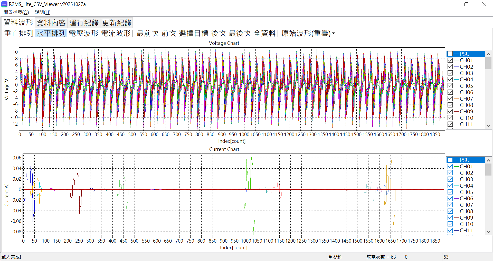
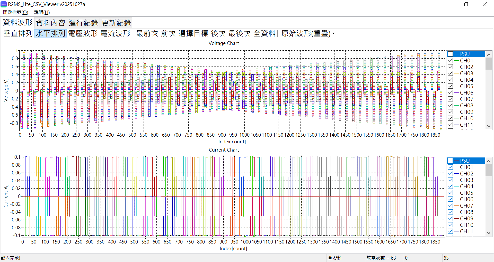

# SwitchArray-2026-S000 維修檢測完成紀錄
+ 室外檢測完成日期: 2026-11-20


### 時間序列檢視
| 室內浮接測試時間序列 PSU:SHOW S000202611241219 |
| :---: |
|  |

| 室內浮接測試時間序列 PSU:HIDE S000202611241219 |
| :---: |
|  |

| 室內標準地層測試時間序列 PSU:SHOW S000202611201450 |
| :---: |
|  |

| 室內標準地層測試時間序列 PSU:HIDE S000202611201450 |
| :---: |
|  |

### R2MS_Lite_CSV_CurrentQC 分析摘要

- **來源檔案**：`S000202611201450.v299T.csv`
- **產生時間**：2026-11-24 12:45:39
- **程式版本**：R2MS_Lite_CSV_CurrentQC v20261030b
- **資料筆數**：原始 1890 筆 → 篩選後 1134 筆（每 10 筆保留 3~8）
- **判定標準**：AVG(MEAS/PSU) > 115.00%
- **BOARD 對應**：CH01–CH08 = BOARD 01、CH09–CH16 = BOARD 02、…、CH57–CH64 = BOARD 08

```
BOARD,CH,AVG(MEAS)[A],AVG(PSU)[A],AVG(MEAS/PSU)[%],count,BOARD,CH,AVG(MEAS)[A],AVG(PSU)[A],AVG(MEAS/PSU)[%],count
01,CH01,0.100023395,0.100026667,100.00,12,02,CH09,0.100823523,0.100051667,100.77,24
01,CH02,0.100899280,0.100038750,100.86,24,02,CH10,0.099782320,0.100052083, 99.73,24
01,CH03,0.100472042,0.100050833,100.42,24,02,CH11,0.099973705,0.100052083, 99.92,24
01,CH04,0.100137717,0.100050833,100.09,24,02,CH12,0.100124342,0.100052083,100.07,24
01,CH05,0.099704560,0.100050417, 99.65,24,02,CH13,0.100042473,0.100052500, 99.99,24
01,CH06,0.099841776,0.100050000, 99.79,24,02,CH14,0.099947930,0.100052083, 99.90,24
01,CH07,0.100017170,0.100050417, 99.97,24,02,CH15,0.099851674,0.100051667, 99.80,24
01,CH08,0.100135714,0.100051250,100.08,24,02,CH16,0.100410943,0.100051667,100.36,24
03,CH17,0.100290171,0.100052083,100.24,24,04,CH25,0.100369603,0.100052500,100.32,24
03,CH18,0.099836123,0.100052083, 99.78,24,04,CH26,0.099950752,0.100052500, 99.90,24
03,CH19,0.099966922,0.100051667, 99.92,24,04,CH27,0.099852320,0.100052083, 99.80,24
03,CH20,0.099862691,0.100050833, 99.81,24,04,CH28,0.100075971,0.100051667,100.02,24
03,CH21,0.099885438,0.100050000, 99.84,24,04,CH29,0.099819946,0.100052083, 99.77,24
03,CH22,0.099909252,0.100050833, 99.86,24,04,CH30,0.099925215,0.100052083, 99.87,24
03,CH23,0.099754855,0.100051667, 99.70,24,04,CH31,0.099944421,0.100052083, 99.89,24
03,CH24,0.100131931,0.100052083,100.08,24,04,CH32,0.099884920,0.100052083, 99.83,24
05,CH33,0.099996113,0.100051667, 99.94,24,06,CH41,0.100128775,0.100051250,100.08,24
05,CH34,0.099776782,0.100052083, 99.72,24,06,CH42,0.099810628,0.100051250, 99.76,24
05,CH35,0.102514849,0.100052500,102.46,24,06,CH43,0.100258103,0.100051250,100.21,24
05,CH36,0.099769114,0.100052500, 99.72,24,06,CH44,0.099954760,0.100051667, 99.90,24
05,CH37,0.100058092,0.100052083,100.01,24,06,CH45,0.100438843,0.100051250,100.39,24
05,CH38,0.099980090,0.100051667, 99.93,24,06,CH46,0.100307152,0.100050833,100.26,24
05,CH39,0.100149599,0.100051667,100.10,24,06,CH47,0.100423891,0.100051250,100.37,24
05,CH40,0.099893421,0.100051250, 99.84,24,06,CH48,0.099922760,0.100051667, 99.87,24
07,CH49,0.099978006,0.100051250, 99.93,24,08,CH57,0.099737678,0.100051250, 99.69,24
07,CH50,0.099819381,0.100050833, 99.77,24,08,CH58,0.100113851,0.100051250,100.06,24
07,CH51,0.099617471,0.100051250, 99.57,24,08,CH59,0.100352687,0.100051250,100.30,24
07,CH52,0.099770631,0.100051250, 99.72,24,08,CH60,0.100133502,0.100051250,100.08,24
07,CH53,0.100695368,0.100051250,100.64,24,08,CH61,0.099899472,0.100051250, 99.85,24
07,CH54,0.099899546,0.100051250, 99.85,24,08,CH62,0.099875040,0.100050833, 99.82,24
07,CH55,0.100287221,0.100051250,100.24,24,08,CH63,0.099944893,0.100050833, 99.89,24
07,CH56,0.101655824,0.100051667,101.60,24,08,CH64,0.100090032,0.100050833,100.04,12
```

超標通道：無


| 野外測試時間序列 PSU:SHOW S000202611201503 |
| :---: |
|  |

| 野外測試時間序列 PSU:HIDE S000202611201503 |
| :---: |
|  |

## R2MS_Lite_CSV_CurrentQC 分析摘要

- **來源檔案**：`S000202611201503.v299T.csv`
- **產生時間**：2026-11-24 12:52:52
- **程式版本**：R2MS_Lite_CSV_CurrentQC v20261030b
- **資料筆數**：原始 1890 筆 → 篩選後 1134 筆（每 10 筆保留 3~8）
- **判定標準**：AVG(MEAS/PSU) > 115.00%
- **BOARD 對應**：CH01–CH08 = BOARD 01、CH09–CH16 = BOARD 02、…、CH57–CH64 = BOARD 08

```
BOARD,CH,AVG(MEAS)[A],AVG(PSU)[A],AVG(MEAS/PSU)[%],count,BOARD,CH,AVG(MEAS)[A],AVG(PSU)[A],AVG(MEAS/PSU)[%],count
01,CH01,0.019177128,0.018351667,104.50,12,02,CH09,0.043514178,0.027825000,156.66,24
01,CH02,0.037376310,0.017256667,219.75,24,02,CH10,0.026000477,0.025793750,100.93,24
01,CH03,0.026071415,0.016921667,153.84,24,02,CH11,0.025185750,0.023423333,107.61,24
01,CH04,0.019350452,0.019019167,101.58,24,02,CH12,0.022940634,0.022359583,102.65,24
01,CH05,0.022402341,0.021221250,105.53,24,02,CH13,0.023025737,0.022269583,103.40,24
01,CH06,0.024327697,0.024254583,100.17,24,02,CH14,0.022874927,0.022635000,101.08,24
01,CH07,0.027518015,0.027060417,101.68,24,02,CH15,0.021550261,0.020779583,103.83,24
01,CH08,0.028191931,0.027877083,101.13,24,02,CH16,0.027592267,0.016092500,179.90,24
03,CH17,0.013688599,0.013374583,102.35,24,04,CH25,0.016066410,0.015707083,102.28,24
03,CH18,0.015153151,0.015091667,100.30,24,04,CH26,0.016430481,0.016219167,101.29,24
03,CH19,0.015561943,0.015381667,101.27,24,04,CH27,0.017031868,0.016950000,100.47,24
03,CH20,0.014380989,0.014272083,100.76,24,04,CH28,0.018467562,0.018206250,101.40,24
03,CH21,0.014476126,0.014377917,100.70,24,04,CH29,0.018518063,0.018404167,100.67,24
03,CH22,0.014831454,0.014645417,101.25,24,04,CH30,0.016816092,0.016627917,101.20,24
03,CH23,0.015522953,0.015456250,100.39,24,04,CH31,0.016069932,0.015923750,100.89,24
03,CH24,0.015907346,0.015724583,101.19,24,04,CH32,0.017850955,0.017709583,100.71,24
05,CH33,0.019871815,0.019352083,102.68,24,06,CH41,0.017583721,0.017413750,100.96,24
05,CH34,0.019191309,0.017696667,108.94,24,06,CH42,0.019766228,0.019711667,100.20,24
05,CH35,0.048676798,0.014592500,341.93,24,06,CH43,0.021547504,0.021370417,100.85,24
05,CH36,0.015094589,0.014497917,103.96,24,06,CH44,0.021424328,0.021312083,100.54,24
05,CH37,0.018335852,0.016547500,110.55,24,06,CH45,0.021245965,0.021095833,100.74,24
05,CH38,0.018088187,0.017518333,103.27,24,06,CH46,0.019878884,0.019637500,101.28,24
05,CH39,0.022792312,0.018017083,126.22,24,06,CH47,0.018928499,0.018708333,101.18,24
05,CH40,0.017924518,0.017756667,101.00,24,06,CH48,0.019582631,0.019475000,100.54,24
07,CH49,0.021271382,0.020519583,103.65,24,08,CH57,0.018479426,0.018315833,101.01,24
07,CH50,0.020869260,0.020445417,102.12,24,08,CH58,0.017262582,0.017140000,100.68,24
07,CH51,0.019901154,0.019468333,102.27,24,08,CH59,0.018973448,0.018800417,100.89,24
07,CH52,0.020629426,0.020225417,101.95,24,08,CH60,0.016664479,0.016564167,100.83,24
07,CH53,0.030548541,0.023714583,128.06,24,08,CH61,0.012918507,0.012709167,101.72,24
07,CH54,0.028342621,0.026648333,106.32,24,08,CH62,0.012764527,0.012669583,100.67,24
07,CH55,0.030431815,0.027806667,109.42,24,08,CH63,0.013726417,0.013563333,101.20,24
07,CH56,0.053995859,0.024290000,235.84,24,08,CH64,0.013652716,0.013747500, 99.31,12
```

超標通道（8 個）：CH02 (219.75%)、CH03 (153.84%)、CH09 (156.66%)、CH16 (179.90%)、CH35 (341.93%)、CH39 (126.22%)、CH53 (128.06%)、CH56 (235.84%)


| NCU草坪時間序列 PSU:SHOW S999202611201408 |
| :---: |
|  |

| NCU草坪時間序列 PSU:HIDE S999202611201408 |
| :---: |
|  |

## R2MS_Lite_CSV_CurrentQC 分析摘要

- **來源檔案**：`S999202611201408.v299S.csv`
- **產生時間**：2026-11-24 11:05:47
- **程式版本**：R2MS_Lite_CSV_CurrentQC v20261030b
- **資料筆數**：原始 19530 筆 → 篩選後 11718 筆（每 10 筆保留 3~8）
- **判定標準**：AVG(MEAS/PSU) > 115.00%
- **BOARD 對應**：CH01–CH08 = BOARD 01、CH09–CH16 = BOARD 02、…、CH57–CH64 = BOARD 08

```
BOARD,CH,AVG(MEAS)[A],AVG(PSU)[A],AVG(MEAS/PSU)[%],count,BOARD,CH,AVG(MEAS)[A],AVG(PSU)[A],AVG(MEAS/PSU)[%],count
01,CH01,0.322575021,0.317918651,101.48,252,02,CH09,0.382280227,0.375492083,101.83,240
01,CH02,0.324742968,0.295528750,110.02,240,02,CH10,0.369879749,0.360979722,102.51,252
01,CH03,0.293937155,0.288988875,101.72,240,02,CH11,0.340907114,0.333722875,102.18,240
01,CH04,0.331848783,0.325078611,102.11,252,02,CH12,0.375687858,0.351283958,107.11,240
01,CH05,0.326288649,0.318639500,102.43,240,02,CH13,0.325838779,0.322584405,101.02,252
01,CH06,0.369966193,0.355247417,104.19,240,02,CH14,0.375915687,0.357682125,105.22,240
01,CH07,0.371735971,0.365968333,101.60,252,02,CH15,0.329027830,0.322308167,102.13,240
01,CH08,0.371223832,0.365461250,101.59,240,02,CH16,0.309219739,0.305997341,101.07,252
03,CH17,0.261427938,0.236298708,110.76,240,04,CH25,0.287231539,0.283801706,101.22,252
03,CH18,0.349933388,0.320509250,109.40,240,04,CH26,0.295205640,0.285951458,103.25,240
03,CH19,0.277066943,0.272341746,101.76,252,04,CH27,0.305418352,0.297217250,102.79,240
03,CH20,0.273735085,0.268917500,101.81,240,04,CH28,0.302285771,0.299248175,101.02,252
03,CH21,0.286156130,0.280365167,102.09,240,04,CH29,0.334597034,0.321618083,104.06,240
03,CH22,0.286081096,0.263897302,108.55,252,04,CH30,0.292643003,0.287828000,101.69,240
03,CH23,0.317522947,0.289412208,109.81,240,04,CH31,0.313078345,0.285093730,109.95,252
03,CH24,0.307504778,0.282738750,108.91,240,04,CH32,0.300402304,0.296048542,101.48,240
05,CH33,0.331113770,0.328155625,100.91,240,06,CH41,0.300863540,0.292115208,103.00,240
05,CH34,0.315765800,0.303572143,104.06,252,06,CH42,0.332903432,0.323172375,103.04,240
05,CH35,0.288722268,0.267203250,108.08,240,06,CH43,0.348034942,0.338883849,102.74,252
05,CH36,0.266180511,0.261853208,101.67,240,06,CH44,0.319624849,0.315398042,101.34,240
05,CH37,0.315875866,0.311533929,101.41,252,06,CH45,0.357849145,0.350192750,102.21,240
05,CH38,0.300051406,0.290969875,103.12,240,06,CH46,0.313624594,0.309735794,101.27,252
05,CH39,0.320627427,0.316954500,101.17,240,06,CH47,0.325060750,0.320146375,101.54,240
05,CH40,0.307679440,0.303686786,101.33,252,06,CH48,0.323534436,0.318162000,101.71,240
07,CH49,0.343228446,0.339445397,101.13,252,08,CH57,0.298211059,0.295961625,100.78,240
07,CH50,0.338911347,0.333837417,101.53,240,08,CH58,0.307344188,0.303575040,101.27,252
07,CH51,0.336640396,0.331219208,101.65,240,08,CH59,0.321670336,0.316653417,101.61,240
07,CH52,0.319844764,0.314918770,101.59,252,08,CH60,0.334326047,0.330426833,101.20,240
07,CH53,0.383767353,0.360560042,106.49,240,08,CH61,0.233507172,0.230475238,101.33,252
07,CH54,0.377589329,0.371585250,101.63,240,08,CH62,0.287757019,0.285636833,100.76,240
07,CH55,0.374006591,0.370649881,100.91,252,08,CH63,0.254049931,0.250588792,101.39,240
07,CH56,0.383816712,0.378857042,101.33,240,08,CH64,0.291393461,0.288962897,100.85,252
```

超標通道：無


### 順推分析
+ 用預設值順推，時間序列解算手動選用實際資料「S999202610281236.v299S.csv」。

### 逆推分析(S999202610281236.v299S.WS.ohm)
+ 測線名稱改為「S999202610281236.v299S.WS」
+ 資料剔除次數改為「1」
+ 色階範圍改為「[50,2000]」
+ 其他維持預設值。  
  | S999202610281236.v299S.WS 逆推結果 |
  | :---: |
  |  |

### 逆推分析(S999202610281236.v299S.WS.PSU.ohm)
+ 測線名稱改為「S999202610281236.v299S.WS.PSU」
+ 資料剔除次數改為「1」
+ 色階範圍改為「[50,2000]」
+ 其他維持預設值。  
  | S999202610281236.v299S.WS.PSU 逆推結果 |
  | :---: |
  |  |

### 逆推分析(S999202610281236.v299S.MPR.ohm)
+ 測線名稱改為「S999202610281236.v299S.MPR」
+ 資料剔除次數改為「1」
+ 色階範圍改為「[50,2000]」
+ 其他維持預設值。  
  | S999202610281236.v299S.MPR 逆推結果 |
  | :---: |
  |  |

### 逆推分析(S999202610281236.v299S.MPR.PSU.ohm)
+ 測線名稱改為「S999202610281236.v299S.MPR.PSU」
+ 資料剔除次數改為「1」
+ 色階範圍改為「[50,2000]」
+ 其他維持預設值。  
  | S999202610281236.v299S.MPR.PSU 逆推結果 |
  | :---: |
  |  |

### 逆推分析(S999202610281236.v299S.MGD.ohm)
+ 測線名稱改為「S999202610281236.v299S.MGD」
+ 資料剔除次數改為「1」
+ 色階範圍改為「[50,2000]」
+ 其他維持預設值。  
  | S999202610281236.v299S.MGD 逆推結果 |
  | :---: |
  |  |

### 逆推分析(S999202610281236.v299S.MGD.PSU.ohm)
+ 測線名稱改為「S999202610281236.v299S.MGD.PSU」
+ 資料剔除次數改為「1」
+ 色階範圍改為「[50,2000]」
+ 其他維持預設值。  
  | S999202610281236.v299S.MGD.PSU 逆推結果 |
  | :---: |
  |  |

### 逆推分析(S999202610281236.v299S.GD.ohm)
+ 測線名稱改為「S999202610281236.v299S.GD」
+ 資料剔除次數改為「1」
+ 色階範圍改為「[50,2000]」
+ 其他維持預設值。  
  | S999202610281236.v299S.GD 逆推結果 |
  | :---: |
  |  |

### 逆推分析(S999202610281236.v299S.GD.PSU.ohm)
+ 測線名稱改為「S999202610281236.v299S.GD.PSU」
+ 資料剔除次數改為「1」
+ 色階範圍改為「[50,2000]」
+ 其他維持預設值。  
  | S999202610281236.v299S.GD.PSU 逆推結果 |
  | :---: |
  |  |


  
