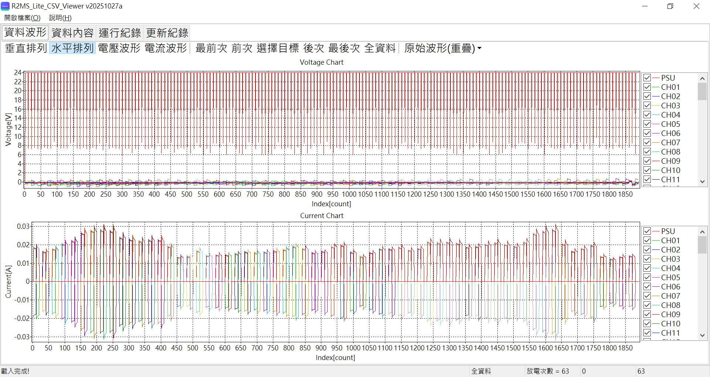

# SwitchArray-2026-S008 維修檢測完成紀錄
+ 室外檢測完成日期: 2026-11-20


### 時間序列檢視
| 室內浮接測試時間序列 PSU:SHOW S008202611231233 |
| :---: |
|  |

| 室內浮接測試時間序列 PSU:HIDE S008202611231233 |
| :---: |
|  |

| 室內標準地層測試時間序列 PSU:SHOW S008202611201354 |
| :---: |
|  |

| 室內標準地層測試時間序列 PSU:HIDE S008202611201354 |
| :---: |
|  |

### R2MS_Lite_CSV_CurrentQC 分析摘要

- **來源檔案**：`S008202611201354.v299T.csv`
- **產生時間**：2026-11-24 10:57:51
- **程式版本**：R2MS_Lite_CSV_CurrentQC v20261030b
- **資料筆數**：原始 1890 筆 → 篩選後 1134 筆（每 10 筆保留 3~8）
- **判定標準**：AVG(MEAS/PSU) > 115.00%
- **BOARD 對應**：CH01–CH08 = BOARD 01、CH09–CH16 = BOARD 02、…、CH57–CH64 = BOARD 08

```
BOARD,CH,AVG(MEAS)[A],AVG(PSU)[A],AVG(MEAS/PSU)[%],count,BOARD,CH,AVG(MEAS)[A],AVG(PSU)[A],AVG(MEAS/PSU)[%],count
01,CH01,0.099985688,0.100027500, 99.96,12,02,CH09,0.099696824,0.100051667, 99.65,24
01,CH02,0.099868357,0.100039583, 99.83,24,02,CH10,0.100018494,0.100051667, 99.97,24
01,CH03,0.100001665,0.100051250, 99.95,24,02,CH11,0.100174357,0.100051667,100.12,24
01,CH04,0.100061093,0.100051250,100.01,24,02,CH12,0.100196985,0.100051250,100.15,24
01,CH05,0.099976362,0.100051250, 99.93,24,02,CH13,0.099967700,0.100051250, 99.92,24
01,CH06,0.099934295,0.100050833, 99.88,24,02,CH14,0.100111049,0.100051667,100.06,24
01,CH07,0.099783552,0.100051250, 99.73,24,02,CH15,0.099961589,0.100051250, 99.91,24
01,CH08,0.099873350,0.100051667, 99.82,24,02,CH16,0.099812364,0.100051250, 99.76,24
03,CH17,0.100291921,0.100051667,100.24,24,04,CH25,0.099834653,0.100052500, 99.78,24
03,CH18,0.099936305,0.100051667, 99.88,24,04,CH26,0.100270553,0.100052500,100.22,24
03,CH19,0.099881952,0.100051667, 99.83,24,04,CH27,0.100395772,0.100052500,100.34,24
03,CH20,0.099833820,0.100051667, 99.78,24,04,CH28,0.099933011,0.100052917, 99.88,24
03,CH21,0.099973686,0.100051250, 99.92,24,04,CH29,0.100137239,0.100052500,100.08,24
03,CH22,0.099937784,0.100051250, 99.89,24,04,CH30,0.099765239,0.100052500, 99.71,24
03,CH23,0.099878448,0.100051667, 99.83,24,04,CH31,0.099932865,0.100052083, 99.88,24
03,CH24,0.100059243,0.100051667,100.01,24,04,CH32,0.099933708,0.100051667, 99.88,24
05,CH33,0.099761983,0.100052083, 99.71,24,06,CH41,0.100086497,0.100051667,100.03,24
05,CH34,0.100230409,0.100052500,100.18,24,06,CH42,0.100213021,0.100051250,100.16,24
05,CH35,0.099878429,0.100052917, 99.83,24,06,CH43,0.099914758,0.100051250, 99.86,24
05,CH36,0.099793584,0.100052917, 99.74,24,06,CH44,0.100089186,0.100051667,100.04,24
05,CH37,0.099926379,0.100052500, 99.87,24,06,CH45,0.099788119,0.100052083, 99.74,24
05,CH38,0.100103684,0.100052083,100.05,24,06,CH46,0.099835904,0.100052500, 99.78,24
05,CH39,0.099937331,0.100051250, 99.89,24,06,CH47,0.100117539,0.100052083,100.07,24
05,CH40,0.099923118,0.100051250, 99.87,24,06,CH48,0.099888727,0.100051667, 99.84,24
07,CH49,0.100093688,0.100051667,100.04,24,08,CH57,0.099524770,0.100051250, 99.47,24
07,CH50,0.099968287,0.100051250, 99.92,24,08,CH58,0.099761144,0.100052083, 99.71,24
07,CH51,0.100284299,0.100050833,100.23,24,08,CH59,0.099961343,0.100051250, 99.91,24
07,CH52,0.099955919,0.100050417, 99.91,24,08,CH60,0.099847241,0.100050417, 99.80,24
07,CH53,0.100164404,0.100050417,100.11,24,08,CH61,0.099756930,0.100051250, 99.71,24
07,CH54,0.100367446,0.100051250,100.32,24,08,CH62,0.099720431,0.100051250, 99.67,24
07,CH55,0.099995307,0.100051667, 99.94,24,08,CH63,0.100152755,0.100051250,100.10,24
07,CH56,0.099907095,0.100051250, 99.86,24,08,CH64,0.099696344,0.100051667, 99.64,12
```

超標通道：無


| 野外測試時間序列 PSU:SHOW S008202611201402 |
| :---: |
|  |

| 野外測試時間序列 PSU:HIDE S008202611201402 |
| :---: |
|  |

### R2MS_Lite_CSV_CurrentQC 分析摘要

- **來源檔案**：`S008202611201402.v299T.csv`
- **產生時間**：2026-11-24 11:02:04
- **程式版本**：R2MS_Lite_CSV_CurrentQC v20261030b
- **資料筆數**：原始 1890 筆 → 篩選後 1134 筆（每 10 筆保留 3~8）
- **判定標準**：AVG(MEAS/PSU) > 115.00%
- **BOARD 對應**：CH01–CH08 = BOARD 01、CH09–CH16 = BOARD 02、…、CH57–CH64 = BOARD 08

```
BOARD,CH,AVG(MEAS)[A],AVG(PSU)[A],AVG(MEAS/PSU)[%],count,BOARD,CH,AVG(MEAS)[A],AVG(PSU)[A],AVG(MEAS/PSU)[%],count
01,CH01,0.018622367,0.018346667,101.51,12,02,CH09,0.027819494,0.027837083, 99.96,24
01,CH02,0.017510779,0.017244583,101.63,24,02,CH10,0.025925918,0.025806667,100.52,24
01,CH03,0.017098666,0.016925000,100.99,24,02,CH11,0.023653914,0.023453750,100.88,24
01,CH04,0.019130969,0.019051667,100.34,24,02,CH12,0.022692277,0.022452500,101.10,24
01,CH05,0.021409976,0.021264167,100.66,24,02,CH13,0.022497690,0.022373750,100.56,24
01,CH06,0.024408814,0.024301250,100.38,24,02,CH14,0.022805155,0.022667500,100.62,24
01,CH07,0.027148246,0.027106667,100.15,24,02,CH15,0.020979981,0.020775000,101.06,24
01,CH08,0.027938584,0.027912500,100.10,24,02,CH16,0.016135425,0.016072083,100.60,24
03,CH17,0.013813007,0.013368333,103.33,24,04,CH25,0.015816623,0.015722500,100.59,24
03,CH18,0.015294228,0.015058750,101.45,24,04,CH26,0.016449340,0.016232917,101.32,24
03,CH19,0.015504545,0.015301667,101.42,24,04,CH27,0.017164517,0.016949583,101.25,24
03,CH20,0.014334968,0.014209167,100.88,24,04,CH28,0.018278600,0.018190000,100.45,24
03,CH21,0.014496230,0.014365833,100.92,24,04,CH29,0.018621813,0.018447500,100.99,24
03,CH22,0.014929387,0.014669583,101.75,24,04,CH30,0.016816550,0.016650417,101.07,24
03,CH23,0.015673448,0.015477917,101.23,24,04,CH31,0.016078732,0.015813750,101.65,24
03,CH24,0.016005218,0.015735833,101.74,24,04,CH32,0.017748044,0.017632083,100.57,24
05,CH33,0.019385176,0.019340417,100.22,24,06,CH41,0.017683476,0.017446250,101.35,24
05,CH34,0.018024627,0.017696250,101.97,24,06,CH42,0.019947519,0.019716667,101.08,24
05,CH35,0.014918329,0.014610000,102.21,24,06,CH43,0.021486998,0.021388333,100.48,24
05,CH36,0.014669508,0.014515417,100.99,24,06,CH44,0.021562949,0.021389167,100.82,24
05,CH37,0.016666926,0.016570417,100.52,24,06,CH45,0.021279810,0.021208333,100.37,24
05,CH38,0.017821359,0.017551667,101.55,24,06,CH46,0.019939585,0.019763750,100.94,24
05,CH39,0.018114332,0.018021667,100.50,24,06,CH47,0.018956313,0.018817083,100.74,24
05,CH40,0.017873010,0.017754583,100.72,24,06,CH48,0.019719461,0.019586250,100.66,24
07,CH49,0.020785669,0.020687917,100.47,24,08,CH57,0.018643675,0.018463750,101.06,24
07,CH50,0.020790515,0.020649583,100.72,24,08,CH58,0.017280309,0.017205000,100.40,24
07,CH51,0.019834223,0.019644167,101.00,24,08,CH59,0.018960554,0.018797083,100.83,24
07,CH52,0.020527526,0.020375417,100.71,24,08,CH60,0.016650330,0.016594583,100.57,24
07,CH53,0.024178127,0.023891667,101.13,24,08,CH61,0.013043034,0.012783333,102.10,24
07,CH54,0.026968271,0.026811667,100.58,24,08,CH62,0.012785570,0.012735833,100.33,24
07,CH55,0.027892142,0.027860000,100.12,24,08,CH63,0.013828151,0.013600417,101.68,24
07,CH56,0.024406084,0.024365000,100.30,24,08,CH64,0.013638937,0.013776667, 99.00,12
```

超標通道：無


| NCU草坪時間序列 PSU:SHOW S999202611201311 |
| :---: |
|  |

| NCU草坪時間序列 PSU:HIDE S999202611201311 |
| :---: |
|  |

### R2MS_Lite_CSV_CurrentQC 分析摘要

- **來源檔案**：`S999202610281236.v299S.csv`
- **產生時間**：2026-10-30 22:27:40
- **程式版本**：R2MS_Lite_CSV_CurrentQC v20261030b
- **資料筆數**：原始 19530 筆 → 篩選後 11718 筆（每 10 筆保留 3~8）
- **判定標準**：AVG(MEAS/PSU) > 115.00%
- **BOARD 對應**：CH01–CH08 = BOARD 01、CH09–CH16 = BOARD 02、…、CH57–CH64 = BOARD 08

```
BOARD,CH,AVG(MEAS)[A],AVG(PSU)[A],AVG(MEAS/PSU)[%],count,BOARD,CH,AVG(MEAS)[A],AVG(PSU)[A],AVG(MEAS/PSU)[%],count
01,CH01,0.313368119,0.305388571,102.66,252,02,CH09,0.432780092,0.432528333,100.05,240
01,CH02,0.451508569,0.439753292,102.79,240,02,CH10,0.414681704,0.413714405,100.23,252
01,CH03,0.434500523,0.423824375,102.57,240,02,CH11,0.429635591,0.427810208,100.43,240
01,CH04,0.407711541,0.398186627,102.44,252,02,CH12,0.375692224,0.373253125,100.66,240
01,CH05,0.447210100,0.441318917,101.39,240,02,CH13,0.416084279,0.415329048,100.18,252
01,CH06,0.474015488,0.458710500,103.46,240,02,CH14,0.435071408,0.433510417,100.36,240
01,CH07,0.452305621,0.440556905,102.74,252,02,CH15,0.422638461,0.422540875,100.02,240
01,CH08,0.458069550,0.454523833,100.79,240,02,CH16,0.330473810,0.329092937,100.43,252
03,CH17,0.433319712,0.420428083,103.19,240,04,CH25,0.357377468,0.343759881,103.92,252
03,CH18,0.373907998,0.350616292,106.83,240,04,CH26,0.355503889,0.350102917,101.57,240
03,CH19,0.367207891,0.358125675,102.57,252,04,CH27,0.323079678,0.319488958,101.12,240
03,CH20,0.363257849,0.344103250,105.75,240,04,CH28,0.334592369,0.329810794,101.44,252
03,CH21,0.327063569,0.297651750,110.03,240,04,CH29,0.314507002,0.301354625,104.38,240
03,CH22,0.297462896,0.277090317,107.41,252,04,CH30,0.365161180,0.359510167,101.55,240
03,CH23,0.349616487,0.318630042,109.85,240,04,CH31,0.327532721,0.325275317,100.69,252
03,CH24,0.320997881,0.317576625,101.08,240,04,CH32,0.349794343,0.346075375,101.07,240
05,CH33,0.411226809,0.404270167,101.70,240,06,CH41,0.391145983,0.384321167,101.73,240
05,CH34,0.363703458,0.354753294,102.48,252,06,CH42,0.458639797,0.449793708,101.97,240
05,CH35,0.342549761,0.335733125,102.00,240,06,CH43,0.440036583,0.438865476,100.27,252
05,CH36,0.395747491,0.385492208,102.58,240,06,CH44,0.458705447,0.454688792,100.88,240
05,CH37,0.401901280,0.383594087,104.53,252,06,CH45,0.454493839,0.448428333,101.35,240
05,CH38,0.439620976,0.432080125,101.69,240,06,CH46,0.438742721,0.434391190,101.00,252
05,CH39,0.407306051,0.401959708,101.30,240,06,CH47,0.465848600,0.458996167,101.49,240
05,CH40,0.381316280,0.371035595,102.63,252,06,CH48,0.463132649,0.460084875,100.66,240
07,CH49,0.447400112,0.444034762,100.76,252,08,CH57,0.466868590,0.460666208,101.37,240
07,CH50,0.454499746,0.451911583,100.58,240,08,CH58,0.461296993,0.457900913,100.74,252
07,CH51,0.459365642,0.457112458,100.49,240,08,CH59,0.468859714,0.463193417,101.24,240
07,CH52,0.453511182,0.449849881,100.81,252,08,CH60,0.446327418,0.440821000,101.27,240
07,CH53,0.471181445,0.466801917,100.96,240,08,CH61,0.430974913,0.423994643,101.68,252
07,CH54,0.469008569,0.463251542,101.25,240,08,CH62,0.447955665,0.439773833,101.91,240
07,CH55,0.469450619,0.458389563,102.43,252,08,CH63,0.415572559,0.404000875,102.91,240
07,CH56,0.467398717,0.462060750,101.16,240,08,CH64,0.413460446,0.406799246,101.66,252
```

超標通道：無


### 順推分析
+ 用預設值順推，時間序列解算手動選用實際資料「S999202610281236.v299S.csv」。

### 逆推分析(S999202610281236.v299S.WS.ohm)
+ 測線名稱改為「S999202610281236.v299S.WS」
+ 資料剔除次數改為「1」
+ 色階範圍改為「[50,2000]」
+ 其他維持預設值。  
  | S999202610281236.v299S.WS 逆推結果 |
  | :---: |
  |  |

### 逆推分析(S999202610281236.v299S.WS.PSU.ohm)
+ 測線名稱改為「S999202610281236.v299S.WS.PSU」
+ 資料剔除次數改為「1」
+ 色階範圍改為「[50,2000]」
+ 其他維持預設值。  
  | S999202610281236.v299S.WS.PSU 逆推結果 |
  | :---: |
  |  |

### 逆推分析(S999202610281236.v299S.MPR.ohm)
+ 測線名稱改為「S999202610281236.v299S.MPR」
+ 資料剔除次數改為「1」
+ 色階範圍改為「[50,2000]」
+ 其他維持預設值。  
  | S999202610281236.v299S.MPR 逆推結果 |
  | :---: |
  |  |

### 逆推分析(S999202610281236.v299S.MPR.PSU.ohm)
+ 測線名稱改為「S999202610281236.v299S.MPR.PSU」
+ 資料剔除次數改為「1」
+ 色階範圍改為「[50,2000]」
+ 其他維持預設值。  
  | S999202610281236.v299S.MPR.PSU 逆推結果 |
  | :---: |
  |  |

### 逆推分析(S999202610281236.v299S.MGD.ohm)
+ 測線名稱改為「S999202610281236.v299S.MGD」
+ 資料剔除次數改為「1」
+ 色階範圍改為「[50,2000]」
+ 其他維持預設值。  
  | S999202610281236.v299S.MGD 逆推結果 |
  | :---: |
  |  |

### 逆推分析(S999202610281236.v299S.MGD.PSU.ohm)
+ 測線名稱改為「S999202610281236.v299S.MGD.PSU」
+ 資料剔除次數改為「1」
+ 色階範圍改為「[50,2000]」
+ 其他維持預設值。  
  | S999202610281236.v299S.MGD.PSU 逆推結果 |
  | :---: |
  |  |

### 逆推分析(S999202610281236.v299S.GD.ohm)
+ 測線名稱改為「S999202610281236.v299S.GD」
+ 資料剔除次數改為「1」
+ 色階範圍改為「[50,2000]」
+ 其他維持預設值。  
  | S999202610281236.v299S.GD 逆推結果 |
  | :---: |
  |  |

### 逆推分析(S999202610281236.v299S.GD.PSU.ohm)
+ 測線名稱改為「S999202610281236.v299S.GD.PSU」
+ 資料剔除次數改為「1」
+ 色階範圍改為「[50,2000]」
+ 其他維持預設值。  
  | S999202610281236.v299S.GD.PSU 逆推結果 |
  | :---: |
  |  |


  
