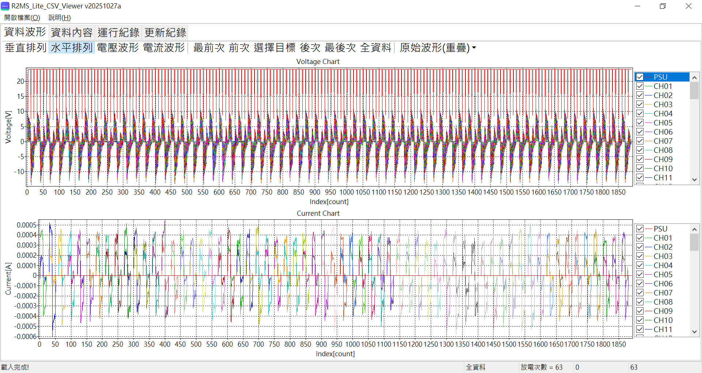
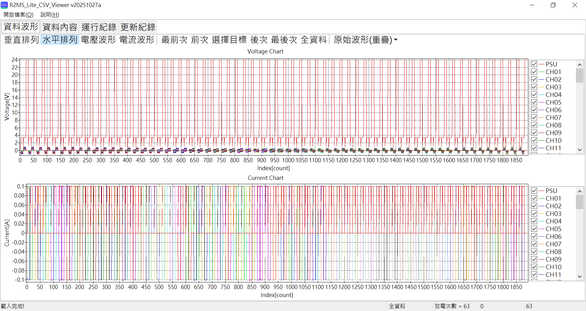
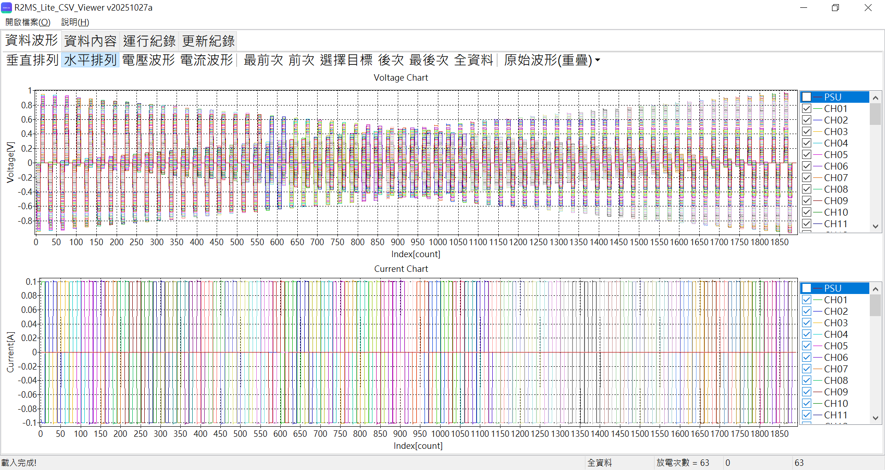

# SwitchArray-2026-S009 維修檢測完成紀錄
+ 室外檢測完成日期: 2026-10-28


### 時間序列檢視
| 室內浮接測試時間序列 PSU:SHOW S009202610281545 |
| :---: |
|  |

| 室內浮接測試時間序列 PSU:HIDE S009202610281545 |
| :---: |
|  |

| 室內標準地層測試時間序列 PSU:SHOW S009202610281551 |
| :---: |
|  |

| 室內標準地層測試時間序列 PSU:HIDE S009202610281551 |
| :---: |
|  |

## R2MS_Lite_CSV_CurrentQC 分析摘要

- **來源檔案**：`S009202610281551.v299T.csv`
- **產生時間**：2026-11-03 14:57:58
- **程式版本**：R2MS_Lite_CSV_CurrentQC v20261030b
- **資料筆數**：原始 1890 筆 → 篩選後 1134 筆（每 10 筆保留 3~8）
- **判定標準**：AVG(MEAS/PSU) > 115.00%
- **BOARD 對應**：CH01–CH08 = BOARD 01、CH09–CH16 = BOARD 02、…、CH57–CH64 = BOARD 08

```
BOARD,CH,AVG(MEAS)[A],AVG(PSU)[A],AVG(MEAS/PSU)[%],count,BOARD,CH,AVG(MEAS)[A],AVG(PSU)[A],AVG(MEAS/PSU)[%],count
01,CH01,0.099745300,0.100019167, 99.73,12,02,CH09,0.099771529,0.100042917, 99.73,24
01,CH02,0.099967801,0.100030833, 99.94,24,02,CH10,0.099807971,0.100043750, 99.76,24
01,CH03,0.099797312,0.100042917, 99.75,24,02,CH11,0.099913718,0.100043333, 99.87,24
01,CH04,0.099956684,0.100042917, 99.91,24,02,CH12,0.099590124,0.100042500, 99.55,24
01,CH05,0.100274511,0.100042917,100.23,24,02,CH13,0.100027747,0.100042917, 99.98,24
01,CH06,0.100467343,0.100042917,100.42,24,02,CH14,0.100544457,0.100042917,100.50,24
01,CH07,0.100151889,0.100042500,100.11,24,02,CH15,0.099908973,0.100042500, 99.87,24
01,CH08,0.100141784,0.100042500,100.10,24,02,CH16,0.100046381,0.100042917,100.00,24
03,CH17,0.100358692,0.100042917,100.32,24,04,CH25,0.099870007,0.100043333, 99.83,24
03,CH18,0.099690846,0.100042917, 99.65,24,04,CH26,0.100008202,0.100043333, 99.96,24
03,CH19,0.099899312,0.100043750, 99.86,24,04,CH27,0.100391278,0.100042917,100.35,24
03,CH20,0.100167554,0.100043750,100.12,24,04,CH28,0.100010725,0.100042917, 99.97,24
03,CH21,0.099736029,0.100043333, 99.69,24,04,CH29,0.099891777,0.100043333, 99.85,24
03,CH22,0.099810527,0.100043750, 99.77,24,04,CH30,0.100460518,0.100043750,100.42,24
03,CH23,0.100213740,0.100043750,100.17,24,04,CH31,0.100227115,0.100043333,100.18,24
03,CH24,0.099850076,0.100043333, 99.81,24,04,CH32,0.099831057,0.100042500, 99.79,24
05,CH33,0.099967041,0.100042917, 99.92,24,06,CH41,0.100016565,0.100043333, 99.97,24
05,CH34,0.099699261,0.100043333, 99.66,24,06,CH42,0.099885745,0.100043333, 99.84,24
05,CH35,0.100029812,0.100042917, 99.99,24,06,CH43,0.099971868,0.100044167, 99.93,24
05,CH36,0.099966783,0.100043333, 99.92,24,06,CH44,0.099872878,0.100044167, 99.83,24
05,CH37,0.100100843,0.100043750,100.06,24,06,CH45,0.099824594,0.100043750, 99.78,24
05,CH38,0.099999801,0.100043750, 99.96,24,06,CH46,0.100142723,0.100043333,100.10,24
05,CH39,0.100035855,0.100044167, 99.99,24,06,CH47,0.099934981,0.100043333, 99.89,24
05,CH40,0.100110261,0.100044167,100.07,24,06,CH48,0.099886830,0.100042917, 99.84,24
07,CH49,0.099826610,0.100043333, 99.78,24,08,CH57,0.100254475,0.100042917,100.21,24
07,CH50,0.099887463,0.100043333, 99.84,24,08,CH58,0.099841350,0.100042500, 99.80,24
07,CH51,0.099834067,0.100042917, 99.79,24,08,CH59,0.100010460,0.100042917, 99.97,24
07,CH52,0.099886212,0.100043750, 99.84,24,08,CH60,0.099910402,0.100042917, 99.87,24
07,CH53,0.099986627,0.100043333, 99.94,24,08,CH61,0.099742831,0.100042500, 99.70,24
07,CH54,0.099896537,0.100042917, 99.85,24,08,CH62,0.099968826,0.100042917, 99.93,24
07,CH55,0.099777116,0.100042917, 99.73,24,08,CH63,0.099927639,0.100043333, 99.88,24
07,CH56,0.100002617,0.100042917, 99.96,24,08,CH64,0.100176028,0.100043333,100.13,12
```

超標通道：無

| 野外測試時間序列 PSU:SHOW S999202610281342 |
| :---: |
|  |

| 野外測試時間序列 PSU:HIDE S999202610281342 |
| :---: |
|  |

### R2MS_Lite_CSV_CurrentQC 分析摘要

- **來源檔案**：`S999202610281342.v299T.csv`
- **產生時間**：2026-10-30 22:28:21
- **程式版本**：R2MS_Lite_CSV_CurrentQC v20261030b
- **資料筆數**：原始 1890 筆 → 篩選後 1134 筆（每 10 筆保留 3~8）
- **判定標準**：AVG(MEAS/PSU) > 115.00%
- **BOARD 對應**：CH01–CH08 = BOARD 01、CH09–CH16 = BOARD 02、…、CH57–CH64 = BOARD 08

```
BOARD,CH,AVG(MEAS)[A],AVG(PSU)[A],AVG(MEAS/PSU)[%],count,BOARD,CH,AVG(MEAS)[A],AVG(PSU)[A],AVG(MEAS/PSU)[%],count
01,CH01,0.019998467,0.019510000,102.51,12,02,CH09,0.029643295,0.029637083,100.09,24
01,CH02,0.023777975,0.023816667, 99.61,24,02,CH10,0.027277307,0.027238333,100.18,24
01,CH03,0.026743746,0.026674583,100.32,24,02,CH11,0.024988255,0.024919167,100.36,24
01,CH04,0.026472013,0.026372917,100.35,24,02,CH12,0.023530511,0.023128333,101.75,24
01,CH05,0.031033430,0.031142083, 99.55,24,02,CH13,0.025322320,0.025377083, 99.71,24
01,CH06,0.035931900,0.035932500, 99.99,24,02,CH14,0.027457561,0.027328750,100.50,24
01,CH07,0.036105192,0.036055833,100.18,24,02,CH15,0.023637411,0.023604583,100.31,24
01,CH08,0.033279544,0.033290000,100.03,24,02,CH16,0.020296644,0.020140417,100.79,24
03,CH17,0.020999553,0.020850417,100.68,24,04,CH25,0.017826664,0.017835833, 99.89,24
03,CH18,0.020662452,0.020291250,101.92,24,04,CH26,0.017887210,0.017724583,101.00,24
03,CH19,0.018830521,0.018818750,100.09,24,04,CH27,0.016926400,0.016681667,101.50,24
03,CH20,0.017014073,0.016959167,100.46,24,04,CH28,0.015772979,0.015764583,100.14,24
03,CH21,0.014411985,0.014248750,101.26,24,04,CH29,0.015645617,0.015353333,101.89,24
03,CH22,0.013796683,0.013572083,101.61,24,04,CH30,0.016562585,0.016565833, 99.88,24
03,CH23,0.014906512,0.014774167,100.79,24,04,CH31,0.017469779,0.017209167,101.55,24
03,CH24,0.016551459,0.016343750,101.20,24,04,CH32,0.018798260,0.018751667,100.11,24
05,CH33,0.021081349,0.021123333, 99.77,24,06,CH41,0.024178824,0.024039167,100.47,24
05,CH34,0.020143845,0.019838333,101.67,24,06,CH42,0.030775220,0.030714583,100.08,24
05,CH35,0.018544997,0.018349167,101.06,24,06,CH43,0.034766499,0.034772500,100.00,24
05,CH36,0.020512168,0.020502917, 99.92,24,06,CH44,0.034432852,0.034469583, 99.92,24
05,CH37,0.023967069,0.023970833, 99.92,24,06,CH45,0.033635280,0.033685417, 99.88,24
05,CH38,0.025957126,0.025875000,100.32,24,06,CH46,0.033897476,0.033975417, 99.77,24
05,CH39,0.024437127,0.024367083,100.37,24,06,CH47,0.036458810,0.036504167, 99.86,24
05,CH40,0.022122936,0.022046667,100.39,24,06,CH48,0.037367323,0.037460417, 99.78,24
07,CH49,0.035229219,0.035235417,100.02,24,08,CH57,0.038781136,0.039024167, 99.38,24
07,CH50,0.034014601,0.034042917, 99.93,24,08,CH58,0.040288759,0.040461250, 99.58,24
07,CH51,0.035394356,0.035386250,100.01,24,08,CH59,0.037690024,0.037710000,100.03,24
07,CH52,0.038063389,0.038154583, 99.74,24,08,CH60,0.031657225,0.031622500,100.17,24
07,CH53,0.040221570,0.040085417,100.35,24,08,CH61,0.028718141,0.028793333, 99.76,24
07,CH54,0.039684821,0.039574583,100.31,24,08,CH62,0.027186603,0.027317083, 99.58,24
07,CH55,0.038931712,0.039029167, 99.76,24,08,CH63,0.025159614,0.025061667,100.43,24
07,CH56,0.038653141,0.038715000, 99.86,24,08,CH64,0.023801102,0.024165833, 98.50,12
```

超標通道：無


| NCU草坪時間序列 PSU:SHOW S999202610281349 |
| :---: |
|  |

| NCU草坪時間序列 PSU:HIDE S999202610281349 |
| :---: |
|  |

### R2MS_Lite_CSV_CurrentQC 分析摘要

- **來源檔案**：`S999202610281349.v299S.csv`
- **產生時間**：2026-10-30 22:28:27
- **程式版本**：R2MS_Lite_CSV_CurrentQC v20261030b
- **資料筆數**：原始 19530 筆 → 篩選後 11718 筆（每 10 筆保留 3~8）
- **判定標準**：AVG(MEAS/PSU) > 115.00%
- **BOARD 對應**：CH01–CH08 = BOARD 01、CH09–CH16 = BOARD 02、…、CH57–CH64 = BOARD 08

```
BOARD,CH,AVG(MEAS)[A],AVG(PSU)[A],AVG(MEAS/PSU)[%],count,BOARD,CH,AVG(MEAS)[A],AVG(PSU)[A],AVG(MEAS/PSU)[%],count
01,CH01,0.347696938,0.312412103,111.49,252,02,CH09,0.448549842,0.437401208,102.61,240
01,CH02,0.457409889,0.444045083,103.13,240,02,CH10,0.434273344,0.418495873,103.88,252
01,CH03,0.474015056,0.429589500,110.71,240,02,CH11,0.440988117,0.432444792,102.04,240
01,CH04,0.433621942,0.405017262,107.24,252,02,CH12,0.435540827,0.386120583,113.21,240
01,CH05,0.450604055,0.445244042,101.25,240,02,CH13,0.422388973,0.419291429,100.75,252
01,CH06,0.471822970,0.462986625,101.95,240,02,CH14,0.477618274,0.437363125,109.74,240
01,CH07,0.500338834,0.445598571,112.69,252,02,CH15,0.443365216,0.430797708,103.02,240
01,CH08,0.468425048,0.457792000,102.40,240,02,CH16,0.339646088,0.335614881,101.23,252
03,CH17,0.499450797,0.425797208,117.56,240,04,CH25,0.354093103,0.350813333,100.93,252
03,CH18,0.427285944,0.357382583,120.02,240,04,CH26,0.370874792,0.357571583,103.75,240
03,CH19,0.368089806,0.363007698,101.42,252,04,CH27,0.343186306,0.329657875,104.07,240
03,CH20,0.353627803,0.348197583,101.61,240,04,CH28,0.338802748,0.336045000,100.82,252
03,CH21,0.309973853,0.303237458,102.26,240,04,CH29,0.330269042,0.307151958,107.57,240
03,CH22,0.337753844,0.283265238,119.27,252,04,CH30,0.371814821,0.366381792,101.46,240
03,CH23,0.396081003,0.324063333,122.51,240,04,CH31,0.411545009,0.334121587,122.55,252
03,CH24,0.390482603,0.323549458,120.57,240,04,CH32,0.360733821,0.355878708,101.36,240
05,CH33,0.414962902,0.410849292,100.99,240,06,CH41,0.402597804,0.388728167,103.48,240
05,CH34,0.381037886,0.359696111,105.84,252,06,CH42,0.465376094,0.453383875,102.65,240
05,CH35,0.390039826,0.340601708,114.00,240,06,CH43,0.465448541,0.442899643,104.99,252
05,CH36,0.396090787,0.389426917,101.68,240,06,CH44,0.460927167,0.456985250,100.86,240
05,CH37,0.393892175,0.389163849,101.19,252,06,CH45,0.461547990,0.452520667,101.98,240
05,CH38,0.461296943,0.435616333,105.68,240,06,CH46,0.442171349,0.438125119,100.92,252
05,CH39,0.411612606,0.407520458,100.99,240,06,CH47,0.466004382,0.461441500,100.99,240
05,CH40,0.380951457,0.375036865,101.52,252,06,CH48,0.470282984,0.463398500,101.49,240
07,CH49,0.451259864,0.447759365,100.78,252,08,CH57,0.464873399,0.463728542,100.25,240
07,CH50,0.460520840,0.454829792,101.26,240,08,CH58,0.466146955,0.460403889,101.27,252
07,CH51,0.465841960,0.460303125,101.21,240,08,CH59,0.470174019,0.464988625,101.13,240
07,CH52,0.458018557,0.453374325,101.02,252,08,CH60,0.446809777,0.443475208,100.76,240
07,CH53,0.494775104,0.468734458,105.70,240,08,CH61,0.426745488,0.424644524,100.50,252
07,CH54,0.472310065,0.465864958,101.39,240,08,CH62,0.443348793,0.442182792,100.27,240
07,CH55,0.464561246,0.461530675,100.66,252,08,CH63,0.412490359,0.409374750,100.77,240
07,CH56,0.469029148,0.464028875,101.09,240,08,CH64,0.411621376,0.410232183,100.35,252
```

超標通道（6 個）：CH17 (117.56%)、CH18 (120.02%)、CH22 (119.27%)、CH23 (122.51%)、CH24 (120.57%)、CH31 (122.55%)


### 順推分析
+ 用預設值順推，時間序列解算手動選用實際資料「S999202610281349.v299S.csv」。

### 逆推分析(S999202610281349.v299S.WS.ohm)
+ 測線名稱改為「S999202610281349.v299S.WS」
+ 資料剔除次數改為「1」
+ 色階範圍改為「[50,2000]」
+ 其他維持預設值。  
  | S999202610281349.v299S.WS 逆推結果 |
  | :---: |
  |  |

### 逆推分析(S999202610281349.v299S.WS.PSU.ohm)
+ 測線名稱改為「S999202610281349.v299S.WS.PSU」
+ 資料剔除次數改為「1」
+ 色階範圍改為「[50,2000]」
+ 其他維持預設值。  
  | S999202610281349.v299S.WS.PSU 逆推結果 |
  | :---: |
  |  |

### 逆推分析(S999202610281349.v299S.MPR.ohm)
+ 測線名稱改為「S999202610281349.v299S.MPR」
+ 資料剔除次數改為「1」
+ 色階範圍改為「[50,2000]」
+ 其他維持預設值。  
  | S999202610281349.v299S.MPR 逆推結果 |
  | :---: |
  |  |

### 逆推分析(S999202610281349.v299S.MPR.PSU.ohm)
+ 測線名稱改為「S999202610281349.v299S.MPR.PSU」
+ 資料剔除次數改為「1」
+ 色階範圍改為「[50,2000]」
+ 其他維持預設值。  
  | S999202610281349.v299S.MPR.PSU 逆推結果 |
  | :---: |
  |  |

### 逆推分析(S999202610281349.v299S.MGD.ohm)
+ 測線名稱改為「S999202610281349.v299S.MGD」
+ 資料剔除次數改為「1」
+ 色階範圍改為「[50,2000]」
+ 其他維持預設值。  
  | S999202610281349.v299S.MGD 逆推結果 |
  | :---: |
  |  |

### 逆推分析(S999202610281236.v299S.MGD.PSU.ohm)
+ 測線名稱改為「S999202610281349.v299S.MGD.PSU」
+ 資料剔除次數改為「1」
+ 色階範圍改為「[50,2000]」
+ 其他維持預設值。  
  | S999202610281349.v299S.MGD.PSU 逆推結果 |
  | :---: |
  |  |

### 逆推分析(S999202610281349.v299S.GD.ohm)
+ 測線名稱改為「S999202610281349.v299S.GD」
+ 資料剔除次數改為「1」
+ 色階範圍改為「[50,2000]」
+ 其他維持預設值。  
  | S999202610281349.v299S.GD 逆推結果 |
  | :---: |
  |  |

### 逆推分析(S999202610281349.v299S.GD.PSU.ohm)
+ 測線名稱改為「S999202610281349.v299S.GD.PSU」
+ 資料剔除次數改為「1」
+ 色階範圍改為「[50,2000]」
+ 其他維持預設值。  
  | S999202610281349.v299S.GD.PSU 逆推結果 |
  | :---: |
  |  |


  
