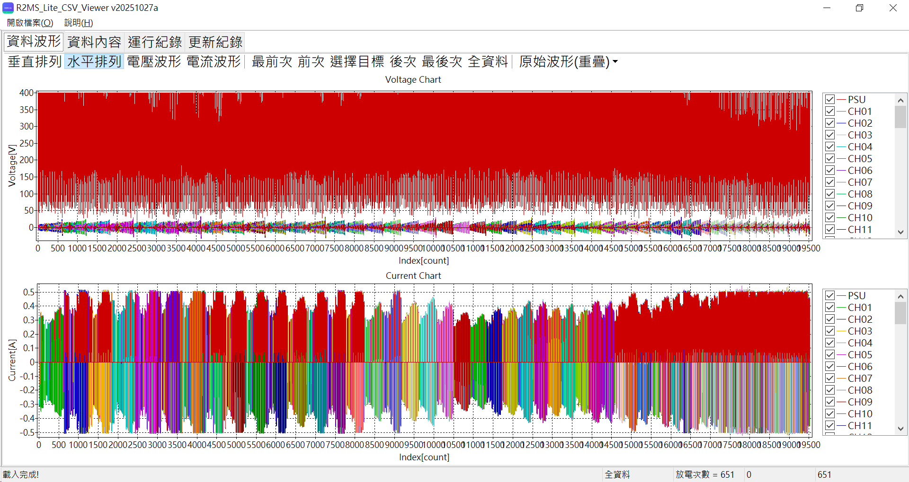
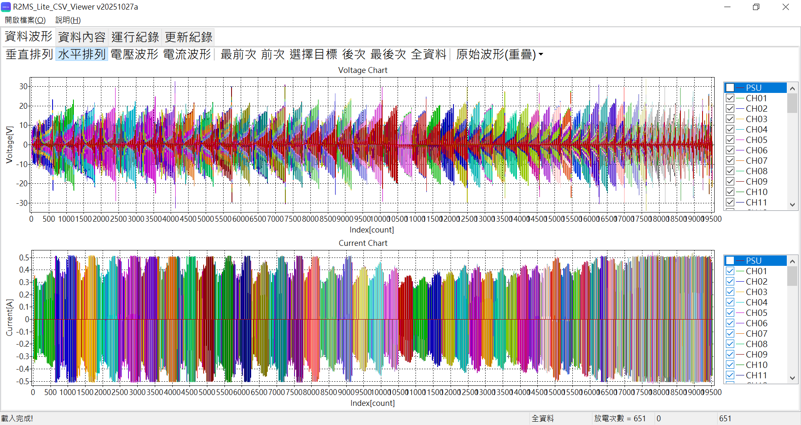
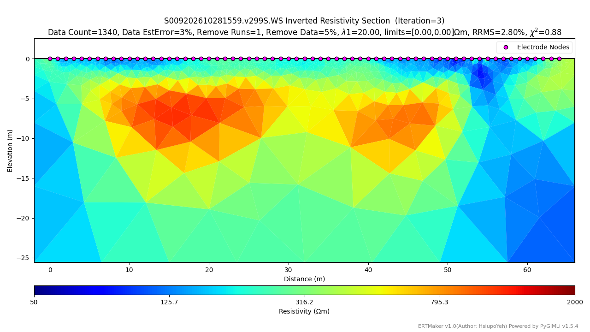
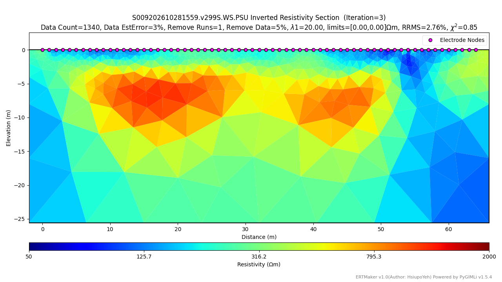

# SwitchArray-2026-S009 維修檢測完成紀錄
+ 室外檢測完成日期: 2026-10-28


### 時間序列檢視
| 室內浮接測試時間序列 PSU:SHOW S009202610281545 |
| :---: |
|  |

| 室內浮接測試時間序列 PSU:HIDE S009202610281545 |
| :---: |
|  |

| 室內標準地層測試時間序列 PSU:SHOW S009202610281551 |
| :---: |
|  |

| 室內標準地層測試時間序列 PSU:HIDE S009202610281551 |
| :---: |
|  |

## R2MS_Lite_CSV_CurrentQC 分析摘要

- **來源檔案**：`S009202610281551.v299T.csv`
- **產生時間**：2026-11-03 14:57:58
- **程式版本**：R2MS_Lite_CSV_CurrentQC v20261030b
- **資料筆數**：原始 1890 筆 → 篩選後 1134 筆（每 10 筆保留 3~8）
- **判定標準**：AVG(MEAS/PSU) > 115.00%
- **BOARD 對應**：CH01–CH08 = BOARD 01、CH09–CH16 = BOARD 02、…、CH57–CH64 = BOARD 08

```
BOARD,CH,AVG(MEAS)[A],AVG(PSU)[A],AVG(MEAS/PSU)[%],count,BOARD,CH,AVG(MEAS)[A],AVG(PSU)[A],AVG(MEAS/PSU)[%],count
01,CH01,0.099745300,0.100019167, 99.73,12,02,CH09,0.099771529,0.100042917, 99.73,24
01,CH02,0.099967801,0.100030833, 99.94,24,02,CH10,0.099807971,0.100043750, 99.76,24
01,CH03,0.099797312,0.100042917, 99.75,24,02,CH11,0.099913718,0.100043333, 99.87,24
01,CH04,0.099956684,0.100042917, 99.91,24,02,CH12,0.099590124,0.100042500, 99.55,24
01,CH05,0.100274511,0.100042917,100.23,24,02,CH13,0.100027747,0.100042917, 99.98,24
01,CH06,0.100467343,0.100042917,100.42,24,02,CH14,0.100544457,0.100042917,100.50,24
01,CH07,0.100151889,0.100042500,100.11,24,02,CH15,0.099908973,0.100042500, 99.87,24
01,CH08,0.100141784,0.100042500,100.10,24,02,CH16,0.100046381,0.100042917,100.00,24
03,CH17,0.100358692,0.100042917,100.32,24,04,CH25,0.099870007,0.100043333, 99.83,24
03,CH18,0.099690846,0.100042917, 99.65,24,04,CH26,0.100008202,0.100043333, 99.96,24
03,CH19,0.099899312,0.100043750, 99.86,24,04,CH27,0.100391278,0.100042917,100.35,24
03,CH20,0.100167554,0.100043750,100.12,24,04,CH28,0.100010725,0.100042917, 99.97,24
03,CH21,0.099736029,0.100043333, 99.69,24,04,CH29,0.099891777,0.100043333, 99.85,24
03,CH22,0.099810527,0.100043750, 99.77,24,04,CH30,0.100460518,0.100043750,100.42,24
03,CH23,0.100213740,0.100043750,100.17,24,04,CH31,0.100227115,0.100043333,100.18,24
03,CH24,0.099850076,0.100043333, 99.81,24,04,CH32,0.099831057,0.100042500, 99.79,24
05,CH33,0.099967041,0.100042917, 99.92,24,06,CH41,0.100016565,0.100043333, 99.97,24
05,CH34,0.099699261,0.100043333, 99.66,24,06,CH42,0.099885745,0.100043333, 99.84,24
05,CH35,0.100029812,0.100042917, 99.99,24,06,CH43,0.099971868,0.100044167, 99.93,24
05,CH36,0.099966783,0.100043333, 99.92,24,06,CH44,0.099872878,0.100044167, 99.83,24
05,CH37,0.100100843,0.100043750,100.06,24,06,CH45,0.099824594,0.100043750, 99.78,24
05,CH38,0.099999801,0.100043750, 99.96,24,06,CH46,0.100142723,0.100043333,100.10,24
05,CH39,0.100035855,0.100044167, 99.99,24,06,CH47,0.099934981,0.100043333, 99.89,24
05,CH40,0.100110261,0.100044167,100.07,24,06,CH48,0.099886830,0.100042917, 99.84,24
07,CH49,0.099826610,0.100043333, 99.78,24,08,CH57,0.100254475,0.100042917,100.21,24
07,CH50,0.099887463,0.100043333, 99.84,24,08,CH58,0.099841350,0.100042500, 99.80,24
07,CH51,0.099834067,0.100042917, 99.79,24,08,CH59,0.100010460,0.100042917, 99.97,24
07,CH52,0.099886212,0.100043750, 99.84,24,08,CH60,0.099910402,0.100042917, 99.87,24
07,CH53,0.099986627,0.100043333, 99.94,24,08,CH61,0.099742831,0.100042500, 99.70,24
07,CH54,0.099896537,0.100042917, 99.85,24,08,CH62,0.099968826,0.100042917, 99.93,24
07,CH55,0.099777116,0.100042917, 99.73,24,08,CH63,0.099927639,0.100043333, 99.88,24
07,CH56,0.100002617,0.100042917, 99.96,24,08,CH64,0.100176028,0.100043333,100.13,12
```

超標通道：無

| 野外測試時間序列 PSU:SHOW 無 |
| :---: |
|  |

| 野外測試時間序列 PSU:HIDE 無 |
| :---: |
|  |


| NCU草坪時間序列 PSU:SHOW S009202610281559 |
| :---: |
|  |

| NCU草坪時間序列 PSU:HIDE S009202610281559 |
| :---: |
|  |

## R2MS_Lite_CSV_CurrentQC 分析摘要

- **來源檔案**：`S009202610281559.v299S.csv`
- **產生時間**：2026-11-03 15:00:23
- **程式版本**：R2MS_Lite_CSV_CurrentQC v20261030b
- **資料筆數**：原始 19530 筆 → 篩選後 11718 筆（每 10 筆保留 3~8）
- **判定標準**：AVG(MEAS/PSU) > 115.00%
- **BOARD 對應**：CH01–CH08 = BOARD 01、CH09–CH16 = BOARD 02、…、CH57–CH64 = BOARD 08

```
BOARD,CH,AVG(MEAS)[A],AVG(PSU)[A],AVG(MEAS/PSU)[%],count,BOARD,CH,AVG(MEAS)[A],AVG(PSU)[A],AVG(MEAS/PSU)[%],count
01,CH01,0.317487259,0.313132381,101.41,252,02,CH09,0.440801583,0.437996917,100.64,240
01,CH02,0.454028365,0.443991208,102.28,240,02,CH10,0.426486719,0.419110714,101.78,252
01,CH03,0.438691546,0.429837167,102.08,240,02,CH11,0.438564508,0.432194208,101.50,240
01,CH04,0.413055264,0.405938175,101.76,252,02,CH12,0.388725888,0.387342708,100.37,240
01,CH05,0.454369645,0.445183458,102.09,240,02,CH13,0.425021482,0.419446230,101.34,252
01,CH06,0.467603257,0.462620458,101.07,240,02,CH14,0.445659819,0.437642125,101.85,240
01,CH07,0.449630539,0.445786429,100.86,252,02,CH15,0.433785276,0.431373458,100.56,240
01,CH08,0.463066205,0.457984542,101.11,240,02,CH16,0.341360493,0.336888571,101.35,252
03,CH17,0.430573807,0.426241417,101.01,240,04,CH25,0.354040588,0.350377381,101.05,252
03,CH18,0.360105100,0.357409542,100.77,240,04,CH26,0.361594546,0.357640333,101.12,240
03,CH19,0.371200217,0.363993452,101.99,252,04,CH27,0.334111884,0.329320792,101.46,240
03,CH20,0.352735869,0.348306083,101.29,240,04,CH28,0.339581912,0.335101786,101.34,252
03,CH21,0.308835196,0.303569375,101.76,240,04,CH29,0.310564652,0.307206250,101.11,240
03,CH22,0.286947301,0.283781667,101.13,252,04,CH30,0.371064594,0.364846042,101.70,240
03,CH23,0.328972653,0.323604125,101.67,240,04,CH31,0.349276816,0.337787857,103.39,252
03,CH24,0.330965451,0.322523208,102.61,240,04,CH32,0.364829284,0.355525583,102.62,240
05,CH33,0.415663048,0.408931458,101.63,240,06,CH41,0.392378885,0.388038958,101.10,240
05,CH34,0.361507931,0.358152778,100.93,252,06,CH42,0.455467500,0.452861208,100.58,240
05,CH35,0.342879121,0.338450375,101.31,240,06,CH43,0.445764966,0.442620833,100.71,252
05,CH36,0.392432864,0.386608250,101.48,240,06,CH44,0.467902288,0.456519125,102.51,240
05,CH37,0.393172411,0.387851825,101.35,252,06,CH45,0.463714333,0.452777167,102.42,240
05,CH38,0.439129825,0.434802000,100.99,240,06,CH46,0.442915695,0.438087897,101.10,252
05,CH39,0.411119655,0.406007083,101.24,240,06,CH47,0.463880208,0.461259333,100.57,240
05,CH40,0.378478320,0.374453294,101.06,252,06,CH48,0.466031982,0.462983083,100.66,240
07,CH49,0.452932690,0.448195357,101.07,252,08,CH57,0.467782615,0.463199583,101.00,240
07,CH50,0.459847957,0.454555792,101.17,240,08,CH58,0.463462983,0.460477183,100.65,252
07,CH51,0.463039440,0.460141833,100.64,240,08,CH59,0.470606415,0.464782417,101.28,240
07,CH52,0.465180881,0.453927500,102.51,252,08,CH60,0.452823962,0.443293167,102.21,240
07,CH53,0.477721736,0.468585500,102.01,240,08,CH61,0.426548015,0.424462183,100.50,252
07,CH54,0.472666364,0.465102708,101.66,240,08,CH62,0.445279477,0.442083833,100.73,240
07,CH55,0.465890228,0.461816270,100.90,252,08,CH63,0.414784604,0.410383708,101.09,240
07,CH56,0.467270881,0.463799083,100.75,240,08,CH64,0.416034532,0.411239524,101.19,252
```

超標通道：無


### 順推分析
+ 用預設值順推，時間序列解算手動選用實際資料「S999202610281349.v299S.csv」。

### 逆推分析(S009202610281559.v299S.WS.ohm)
+ 測線名稱改為「S009202610281559.v299S.WS」
+ 資料剔除次數改為「1」
+ 色階範圍改為「[50,2000]」
+ 其他維持預設值。  
  | S009202610281559.v299S.WS 逆推結果 |
  | :---: |
  |  |

### 逆推分析(S009202610281559.v299S.WS.PSU.ohm)
+ 測線名稱改為「S009202610281559.v299S.WS.PSU」
+ 資料剔除次數改為「1」
+ 色階範圍改為「[50,2000]」
+ 其他維持預設值。  
  | S009202610281559.v299S.WS.PSU 逆推結果 |
  | :---: |
  |  |

### 逆推分析(S999202610281349.v299S.MPR.ohm)
+ 測線名稱改為「S999202610281349.v299S.MPR」
+ 資料剔除次數改為「1」
+ 色階範圍改為「[50,2000]」
+ 其他維持預設值。  
  | S999202610281349.v299S.MPR 逆推結果 |
  | :---: |
  |  |

### 逆推分析(S999202610281349.v299S.MPR.PSU.ohm)
+ 測線名稱改為「S999202610281349.v299S.MPR.PSU」
+ 資料剔除次數改為「1」
+ 色階範圍改為「[50,2000]」
+ 其他維持預設值。  
  | S999202610281349.v299S.MPR.PSU 逆推結果 |
  | :---: |
  |  |

### 逆推分析(S999202610281349.v299S.MGD.ohm)
+ 測線名稱改為「S999202610281349.v299S.MGD」
+ 資料剔除次數改為「1」
+ 色階範圍改為「[50,2000]」
+ 其他維持預設值。  
  | S999202610281349.v299S.MGD 逆推結果 |
  | :---: |
  |  |

### 逆推分析(S999202610281236.v299S.MGD.PSU.ohm)
+ 測線名稱改為「S999202610281349.v299S.MGD.PSU」
+ 資料剔除次數改為「1」
+ 色階範圍改為「[50,2000]」
+ 其他維持預設值。  
  | S999202610281349.v299S.MGD.PSU 逆推結果 |
  | :---: |
  |  |

### 逆推分析(S999202610281349.v299S.GD.ohm)
+ 測線名稱改為「S999202610281349.v299S.GD」
+ 資料剔除次數改為「1」
+ 色階範圍改為「[50,2000]」
+ 其他維持預設值。  
  | S999202610281349.v299S.GD 逆推結果 |
  | :---: |
  |  |

### 逆推分析(S999202610281349.v299S.GD.PSU.ohm)
+ 測線名稱改為「S999202610281349.v299S.GD.PSU」
+ 資料剔除次數改為「1」
+ 色階範圍改為「[50,2000]」
+ 其他維持預設值。  
  | S999202610281349.v299S.GD.PSU 逆推結果 |
  | :---: |
  |  |


  
