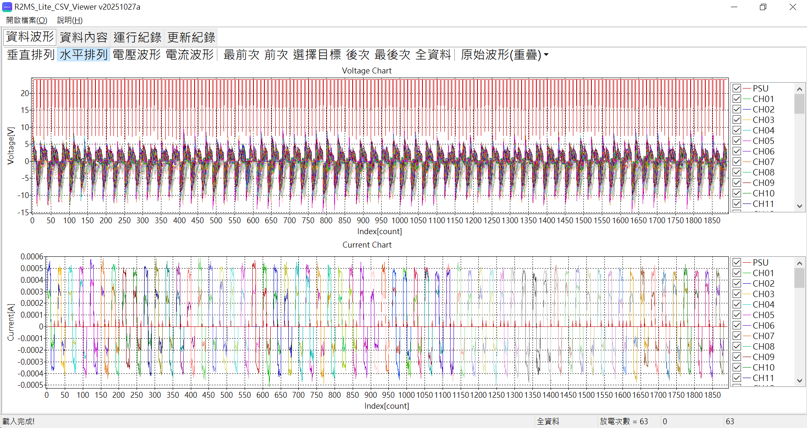
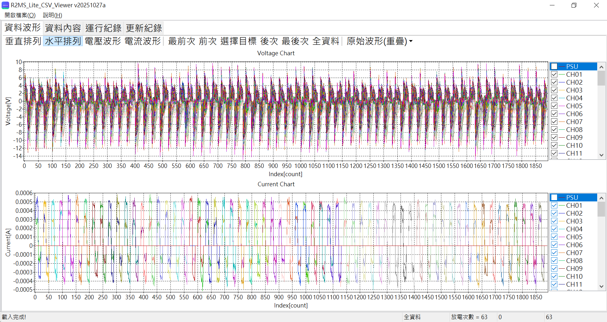
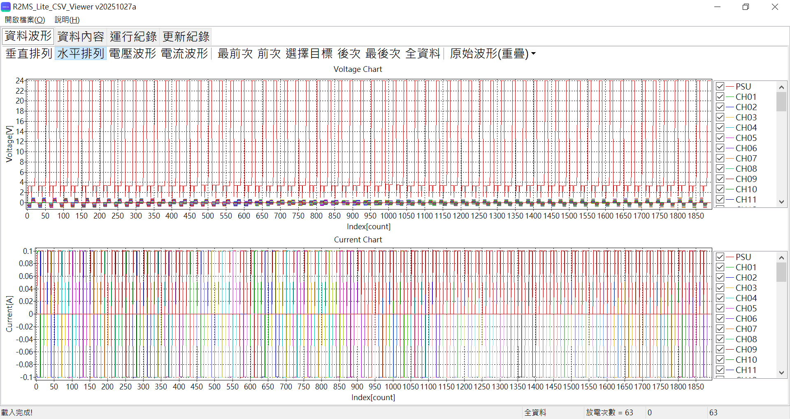
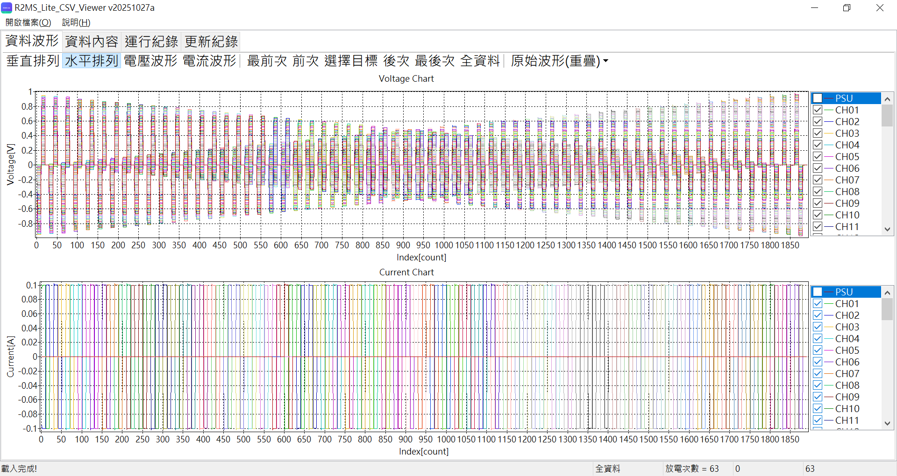
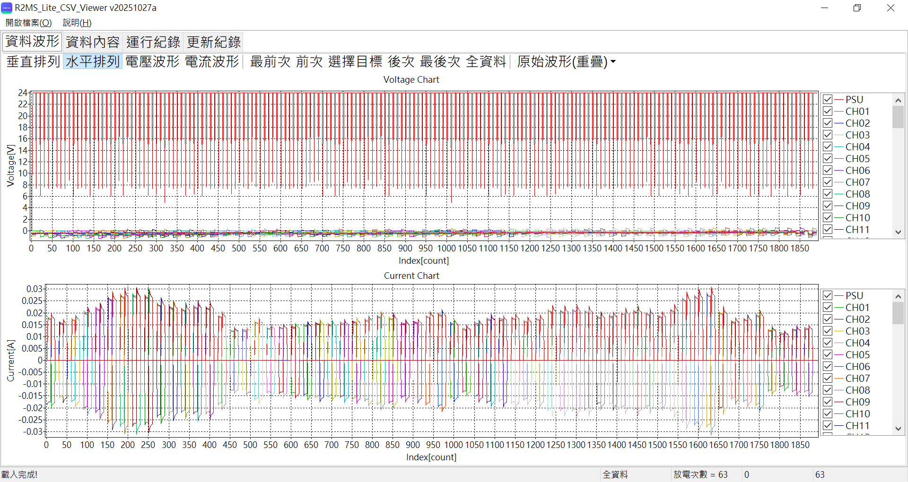
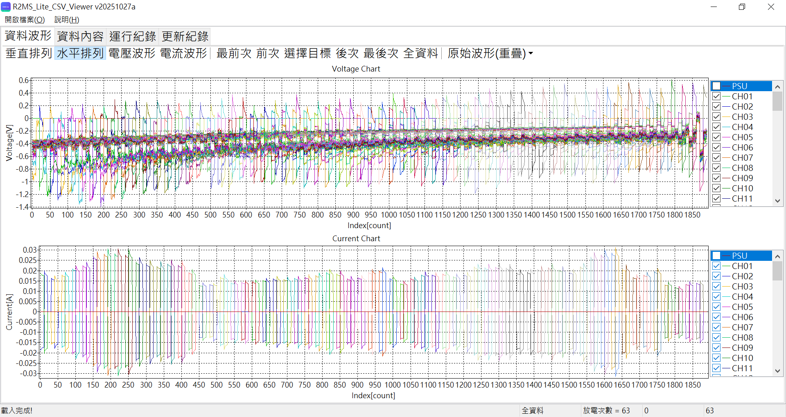
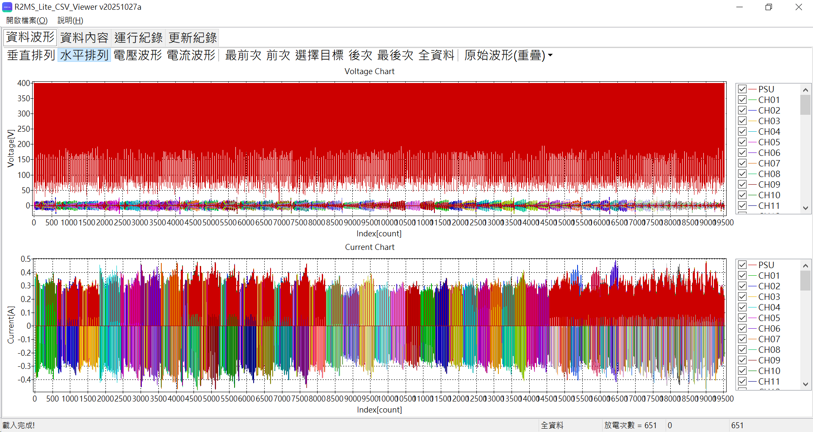
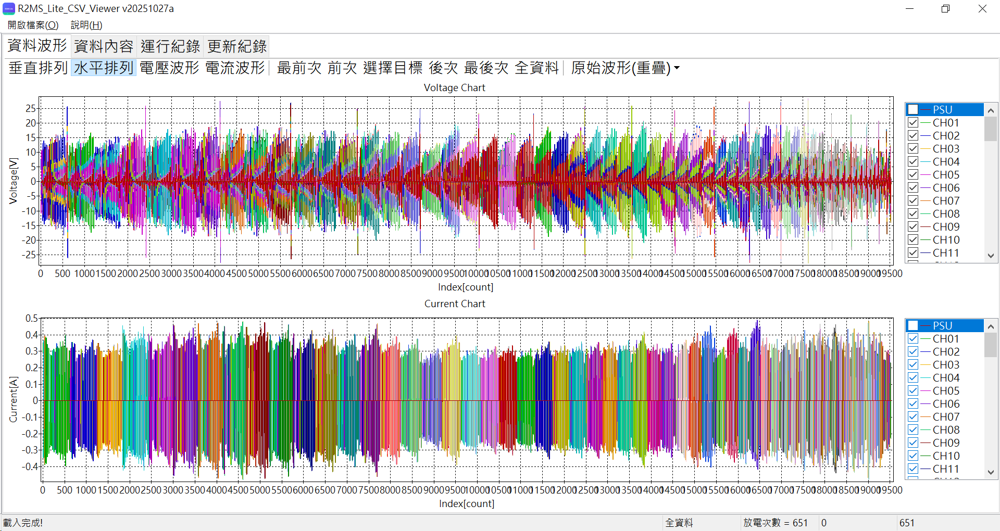
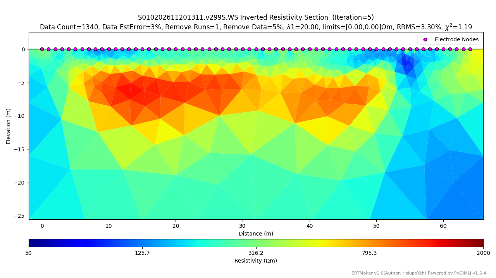

# SwitchArray-2026-S010 維修檢測完成紀錄
+ 室外檢測完成日期: 2026-11-20


### 時間序列檢視
| 室內浮接測試時間序列 PSU:SHOW S010202611231331 |
| :---: |
|  |

| 室內浮接測試時間序列 PSU:HIDE S010202611231331 |
| :---: |
|  |

| 室內標準地層測試時間序列 PSU:SHOW S010202611201247 |
| :---: |
|  |

| 室內標準地層測試時間序列 PSU:HIDE S010202611201247 |
| :---: |
|  |

# R2MS_Lite_CSV_CurrentQC 分析摘要

- **來源檔案**：`S010202611201247.v299T.csv`
- **產生時間**：2026-11-23 12:56:57
- **程式版本**：R2MS_Lite_CSV_CurrentQC v20261030b
- **資料筆數**：原始 1890 筆 → 篩選後 1134 筆（每 10 筆保留 3~8）
- **判定標準**：AVG(MEAS/PSU) > 115.00%
- **BOARD 對應**：CH01–CH08 = BOARD 01、CH09–CH16 = BOARD 02、…、CH57–CH64 = BOARD 08

```
BOARD,CH,AVG(MEAS)[A],AVG(PSU)[A],AVG(MEAS/PSU)[%],count,BOARD,CH,AVG(MEAS)[A],AVG(PSU)[A],AVG(MEAS/PSU)[%],count
01,CH01,0.099978047,0.100024167, 99.95,12,02,CH09,0.099838167,0.100047083, 99.79,24
01,CH02,0.100312392,0.100035000,100.28,24,02,CH10,0.099877504,0.100047083, 99.83,24
01,CH03,0.100303445,0.100046250,100.26,24,02,CH11,0.100082475,0.100048333,100.03,24
01,CH04,0.100213007,0.100046667,100.17,24,02,CH12,0.099894526,0.100048750, 99.85,24
01,CH05,0.100211157,0.100045833,100.17,24,02,CH13,0.100214166,0.100048333,100.17,24
01,CH06,0.100009814,0.100045417, 99.96,24,02,CH14,0.099743244,0.100047500, 99.70,24
01,CH07,0.100220423,0.100045833,100.17,24,02,CH15,0.099897155,0.100047917, 99.85,24
01,CH08,0.100205825,0.100046667,100.16,24,02,CH16,0.099622257,0.100049583, 99.57,24
03,CH17,0.100125015,0.100049167,100.08,24,04,CH25,0.100103679,0.100046250,100.06,24
03,CH18,0.100023148,0.100047917, 99.98,24,04,CH26,0.099819574,0.100045833, 99.77,24
03,CH19,0.099979623,0.100047083, 99.93,24,04,CH27,0.100067557,0.100047500,100.02,24
03,CH20,0.099730596,0.100046667, 99.68,24,04,CH28,0.099895625,0.100048750, 99.85,24
03,CH21,0.100173165,0.100046667,100.13,24,04,CH29,0.100160843,0.100047917,100.11,24
03,CH22,0.100007849,0.100046250, 99.96,24,04,CH30,0.099720304,0.100047917, 99.67,24
03,CH23,0.099700113,0.100047083, 99.65,24,04,CH31,0.099913159,0.100048333, 99.86,24
03,CH24,0.099906715,0.100047500, 99.86,24,04,CH32,0.100068183,0.100047500,100.02,24
05,CH33,0.100053045,0.100047500,100.01,24,06,CH41,0.099864376,0.100048750, 99.82,24
05,CH34,0.099870495,0.100047083, 99.82,24,06,CH42,0.100136484,0.100047083,100.09,24
05,CH35,0.099915981,0.100046250, 99.87,24,06,CH43,0.099780451,0.100046250, 99.73,24
05,CH36,0.099925055,0.100047083, 99.88,24,06,CH44,0.099855403,0.100047500, 99.81,24
05,CH37,0.099942191,0.100048333, 99.89,24,06,CH45,0.100095071,0.100047500,100.05,24
05,CH38,0.100282494,0.100048750,100.23,24,06,CH46,0.099877656,0.100047500, 99.83,24
05,CH39,0.100115835,0.100048333,100.07,24,06,CH47,0.099783479,0.100048750, 99.73,24
05,CH40,0.099959413,0.100048750, 99.91,24,06,CH48,0.100374389,0.100048750,100.33,24
07,CH49,0.099924217,0.100047083, 99.88,24,08,CH57,0.100233510,0.100047500,100.19,24
07,CH50,0.099913319,0.100046667, 99.87,24,08,CH58,0.100033793,0.100047500, 99.99,24
07,CH51,0.099919682,0.100047083, 99.87,24,08,CH59,0.099992279,0.100047083, 99.95,24
07,CH52,0.100062325,0.100046667,100.02,24,08,CH60,0.099887848,0.100048333, 99.84,24
07,CH53,0.099775110,0.100046667, 99.73,24,08,CH61,0.100126046,0.100047500,100.08,24
07,CH54,0.099948682,0.100045833, 99.90,24,08,CH62,0.099478510,0.100045833, 99.43,24
07,CH55,0.100311746,0.100046250,100.27,24,08,CH63,0.099929196,0.100047500, 99.88,24
07,CH56,0.100238965,0.100047083,100.19,24,08,CH64,0.100148242,0.100049167,100.10,12
```

超標通道：無


| 野外測試時間序列 PSU:SHOW S010202611201303 |
| :---: |
|  |

| 野外測試時間序列 PSU:HIDE S010202611201303 |
| :---: |
|  |

# R2MS_Lite_CSV_CurrentQC 分析摘要

- **來源檔案**：`S010202611201303.v299T.csv`
- **產生時間**：2026-11-23 13:08:00
- **程式版本**：R2MS_Lite_CSV_CurrentQC v20261030b
- **資料筆數**：原始 1890 筆 → 篩選後 1134 筆（每 10 筆保留 3~8）
- **判定標準**：AVG(MEAS/PSU) > 115.00%
- **BOARD 對應**：CH01–CH08 = BOARD 01、CH09–CH16 = BOARD 02、…、CH57–CH64 = BOARD 08

```
BOARD,CH,AVG(MEAS)[A],AVG(PSU)[A],AVG(MEAS/PSU)[%],count,BOARD,CH,AVG(MEAS)[A],AVG(PSU)[A],AVG(MEAS/PSU)[%],count
01,CH01,0.018133364,0.017855833,101.57,12,02,CH09,0.027241918,0.027236667,100.04,24
01,CH02,0.016983983,0.016739583,101.55,24,02,CH10,0.025326341,0.025331250,100.04,24
01,CH03,0.016638641,0.016474167,100.95,24,02,CH11,0.023203848,0.023093750,100.51,24
01,CH04,0.018919746,0.018714167,101.01,24,02,CH12,0.022005719,0.022026667, 99.94,24
01,CH05,0.021096107,0.020902500,100.90,24,02,CH13,0.022276774,0.022090417,100.85,24
01,CH06,0.023920778,0.023884583,100.08,24,02,CH14,0.022349151,0.022417083, 99.72,24
01,CH07,0.026791420,0.026730417,100.23,24,02,CH15,0.020540632,0.020405000,100.74,24
01,CH08,0.027531867,0.027447917,100.32,24,02,CH16,0.015557789,0.015518750,100.53,24
03,CH17,0.012967794,0.012544583,103.37,24,04,CH25,0.015569140,0.015338750,101.50,24
03,CH18,0.014489511,0.014375417,100.63,24,04,CH26,0.015988549,0.015905833,100.50,24
03,CH19,0.015030727,0.014807917,101.60,24,04,CH27,0.016759939,0.016628750,100.77,24
03,CH20,0.013770661,0.013671667,100.72,24,04,CH28,0.017869676,0.017814167,100.27,24
03,CH21,0.014044473,0.013910000,100.97,24,04,CH29,0.018314636,0.018197083,100.69,24
03,CH22,0.014530287,0.014386667,100.97,24,04,CH30,0.016776695,0.016644167,100.89,24
03,CH23,0.015183447,0.015150417,100.19,24,04,CH31,0.015885950,0.015780417,100.66,24
03,CH24,0.015451382,0.015312917,100.94,24,04,CH32,0.017505013,0.017381250,100.62,24
05,CH33,0.019075673,0.018963333,100.59,24,06,CH41,0.017147967,0.017003750,100.83,24
05,CH34,0.017612001,0.017373333,101.51,24,06,CH42,0.019389216,0.019291250,100.41,24
05,CH35,0.014541871,0.014380833,101.22,24,06,CH43,0.020999540,0.021011667, 99.96,24
05,CH36,0.014624418,0.014290000,102.24,24,06,CH44,0.021202422,0.021108333,100.46,24
05,CH37,0.016414170,0.016335833,100.39,24,06,CH45,0.021078266,0.020965000,100.57,24
05,CH38,0.017661796,0.017256250,102.37,24,06,CH46,0.019678507,0.019465417,101.16,24
05,CH39,0.017611474,0.017518333,100.52,24,06,CH47,0.018622114,0.018436667,101.01,24
05,CH40,0.017309089,0.017194167,100.73,24,06,CH48,0.019439411,0.019212083,101.16,24
07,CH49,0.020409582,0.020318333,100.44,24,08,CH57,0.018408400,0.018129583,101.63,24
07,CH50,0.020330595,0.020199167,100.70,24,08,CH58,0.016898180,0.016767083,100.75,24
07,CH51,0.019267745,0.019151250,100.65,24,08,CH59,0.018268762,0.018140833,100.66,24
07,CH52,0.020147812,0.020051667,100.42,24,08,CH60,0.015896394,0.015822917,100.77,24
07,CH53,0.023669113,0.023689167, 99.84,24,08,CH61,0.012283440,0.011938750,102.97,24
07,CH54,0.026474701,0.026463750,100.04,24,08,CH62,0.012119781,0.012077083,100.22,24
07,CH55,0.027455152,0.027339583,100.43,24,08,CH63,0.013365456,0.013177917,101.42,24
07,CH56,0.023957798,0.023871667,100.51,24,08,CH64,0.013263450,0.013406667, 98.93,12
```

超標通道：無


| NCU草坪時間序列 PSU:SHOW S010202611201311 |
| :---: |
|  |

| NCU草坪時間序列 PSU:HIDE S010202611201311 |
| :---: |
|  |

# R2MS_Lite_CSV_CurrentQC 分析摘要

- **來源檔案**：`S010202611201311.v299S.csv`
- **產生時間**：2026-11-23 13:55:32
- **程式版本**：R2MS_Lite_CSV_CurrentQC v20261030b
- **資料筆數**：原始 19530 筆 → 篩選後 11718 筆（每 10 筆保留 3~8）
- **判定標準**：AVG(MEAS/PSU) > 115.00%
- **BOARD 對應**：CH01–CH08 = BOARD 01、CH09–CH16 = BOARD 02、…、CH57–CH64 = BOARD 08

```
BOARD,CH,AVG(MEAS)[A],AVG(PSU)[A],AVG(MEAS/PSU)[%],count,BOARD,CH,AVG(MEAS)[A],AVG(PSU)[A],AVG(MEAS/PSU)[%],count
01,CH01,0.324323804,0.316902262,102.38,252,02,CH09,0.380609894,0.374733500,101.59,240
01,CH02,0.301086218,0.293478083,102.62,240,02,CH10,0.363779815,0.360648333,100.88,252
01,CH03,0.296083554,0.287847083,102.89,240,02,CH11,0.338730605,0.333242500,101.67,240
01,CH04,0.358115805,0.324483889,110.58,252,02,CH12,0.353208186,0.350313708,100.84,240
01,CH05,0.329651300,0.317534708,103.87,240,02,CH13,0.330465545,0.323234881,102.29,252
01,CH06,0.361742174,0.354189333,102.16,240,02,CH14,0.359210786,0.357312250,100.54,240
01,CH07,0.372499279,0.365689167,101.88,252,02,CH15,0.326442326,0.322133125,101.36,240
01,CH08,0.370180236,0.364429375,101.59,240,02,CH16,0.307637311,0.305286032,100.79,252
03,CH17,0.258582130,0.233252292,110.98,240,04,CH25,0.294827639,0.283137937,104.19,252
03,CH18,0.328836007,0.320099375,102.78,240,04,CH26,0.292505393,0.285790542,102.37,240
03,CH19,0.277921755,0.271582222,102.38,252,04,CH27,0.304355849,0.297200375,102.44,240
03,CH20,0.271436014,0.266909333,101.71,240,04,CH28,0.302541968,0.298951032,101.22,252
03,CH21,0.285982206,0.279965000,102.18,240,04,CH29,0.331843006,0.320961542,103.41,240
03,CH22,0.268872358,0.263820357,101.94,252,04,CH30,0.294411628,0.289126167,101.85,240
03,CH23,0.293227246,0.289282375,101.38,240,04,CH31,0.286474099,0.282679484,101.36,252
03,CH24,0.287070195,0.282426417,101.67,240,04,CH32,0.302887623,0.296121750,102.30,240
05,CH33,0.337864014,0.328184875,102.99,240,06,CH41,0.297784187,0.291756500,102.07,240
05,CH34,0.344493607,0.303520238,113.73,252,06,CH42,0.327205659,0.322492125,101.48,240
05,CH35,0.270765331,0.267431083,101.25,240,06,CH43,0.342123768,0.338877302,100.97,252
05,CH36,0.327667477,0.261636250,125.48,240,06,CH44,0.318706561,0.315634958,100.98,240
05,CH37,0.317126277,0.311487500,101.83,252,06,CH45,0.367252806,0.350690958,104.79,240
05,CH38,0.350877133,0.290768375,120.62,240,06,CH46,0.320421988,0.310199960,103.35,252
05,CH39,0.320423813,0.316299667,101.32,240,06,CH47,0.347666927,0.319698250,108.71,240
05,CH40,0.307075709,0.302796587,101.43,252,06,CH48,0.329148390,0.318563750,103.38,240
07,CH49,0.344625578,0.339815198,101.44,252,08,CH57,0.301780055,0.296465125,101.82,240
07,CH50,0.340420243,0.334204833,101.88,240,08,CH58,0.310064356,0.303544960,102.20,252
07,CH51,0.334679407,0.330294208,101.35,240,08,CH59,0.321192281,0.315275375,101.91,240
07,CH52,0.319043624,0.315403452,101.17,252,08,CH60,0.340268070,0.331150917,102.82,240
07,CH53,0.364573257,0.361377917,100.90,240,08,CH61,0.234518811,0.226801905,103.44,252
07,CH54,0.375136450,0.372108333,100.83,240,08,CH62,0.290064114,0.285063458,101.78,240
07,CH55,0.375292198,0.371058095,101.15,252,08,CH63,0.255298592,0.250352792,101.99,240
07,CH56,0.383136736,0.378789833,101.16,240,08,CH64,0.291825406,0.288300317,101.24,252
```

超標通道（2 個）：CH36 (125.48%)、CH38 (120.62%)


### 順推分析
+ 用預設值順推，時間序列解算手動選用實際資料「S010202611201311.v299S.csv」。

### 逆推分析(S010202611201311.v299S.WS.ohm)
+ 測線名稱改為「S010202611201311.v299S.WS」
+ 資料剔除次數改為「1」
+ 色階範圍改為「[50,2000]」
+ 其他維持預設值。  
  | S010202611201311.v299S.WS 逆推結果 |
  | :---: |
  |  |

### 逆推分析(S999202610281236.v299S.WS.PSU.ohm)
+ 測線名稱改為「S999202610281236.v299S.WS.PSU」
+ 資料剔除次數改為「1」
+ 色階範圍改為「[50,2000]」
+ 其他維持預設值。  
  | S999202610281236.v299S.WS.PSU 逆推結果 |
  | :---: |
  |  |

### 逆推分析(S999202610281236.v299S.MPR.ohm)
+ 測線名稱改為「S999202610281236.v299S.MPR」
+ 資料剔除次數改為「1」
+ 色階範圍改為「[50,2000]」
+ 其他維持預設值。  
  | S999202610281236.v299S.MPR 逆推結果 |
  | :---: |
  |  |

### 逆推分析(S999202610281236.v299S.MPR.PSU.ohm)
+ 測線名稱改為「S999202610281236.v299S.MPR.PSU」
+ 資料剔除次數改為「1」
+ 色階範圍改為「[50,2000]」
+ 其他維持預設值。  
  | S999202610281236.v299S.MPR.PSU 逆推結果 |
  | :---: |
  |  |

### 逆推分析(S999202610281236.v299S.MGD.ohm)
+ 測線名稱改為「S999202610281236.v299S.MGD」
+ 資料剔除次數改為「1」
+ 色階範圍改為「[50,2000]」
+ 其他維持預設值。  
  | S999202610281236.v299S.MGD 逆推結果 |
  | :---: |
  |  |

### 逆推分析(S999202610281236.v299S.MGD.PSU.ohm)
+ 測線名稱改為「S999202610281236.v299S.MGD.PSU」
+ 資料剔除次數改為「1」
+ 色階範圍改為「[50,2000]」
+ 其他維持預設值。  
  | S999202610281236.v299S.MGD.PSU 逆推結果 |
  | :---: |
  |  |

### 逆推分析(S999202610281236.v299S.GD.ohm)
+ 測線名稱改為「S999202610281236.v299S.GD」
+ 資料剔除次數改為「1」
+ 色階範圍改為「[50,2000]」
+ 其他維持預設值。  
  | S999202610281236.v299S.GD 逆推結果 |
  | :---: |
  |  |

### 逆推分析(S999202610281236.v299S.GD.PSU.ohm)
+ 測線名稱改為「S999202610281236.v299S.GD.PSU」
+ 資料剔除次數改為「1」
+ 色階範圍改為「[50,2000]」
+ 其他維持預設值。  
  | S999202610281236.v299S.GD.PSU 逆推結果 |
  | :---: |
  |  |


  
